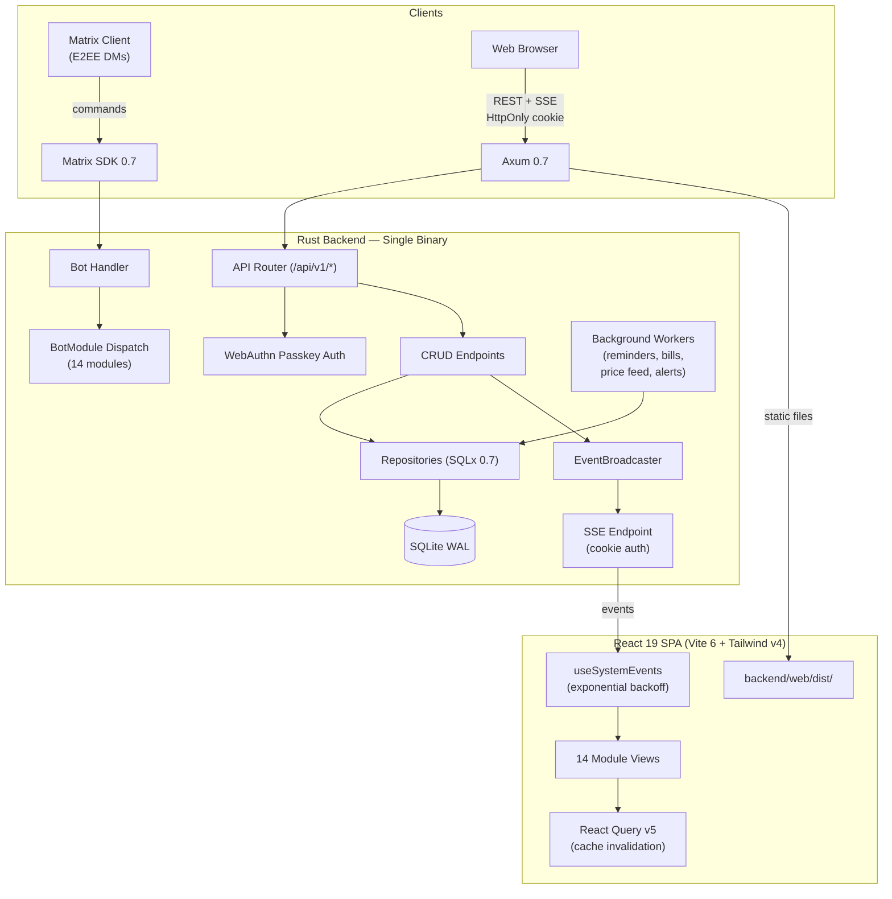

# Architecture Review & Refinement Proposal

**Project**: matrix-hello-bot  
**Date**: 2026-09-09  
**Scope**: Full codebase — Rust backend, React 19 SPA, Docker/CI, existing documentation  

---

## Executive Summary

matrix-hello-bot is a mature, well-engineered Rust + React 19 application that combines a **Matrix chat bot** (with E2EE via `matrix-sdk` 0.7) and an **embedded Axum REST API** with a **React SPA dashboard** — all shipped as a single binary. Fourteen feature modules cover personal productivity, finance, life tracking, and AI assistance.

The project already has an existing [QA audit](file:///d:/01_Data/code/matrix-hello-bot/QA_PRODUCTION_READINESS.md) (dated 2026-09-05) and a [product roadmap](file:///d:/01_Data/code/matrix-hello-bot/ROADMAP.md). This review complements both by examining the system from a **software architecture** perspective — structural health, code quality, frontend craft, operational readiness, and a prioritised refinement plan that weaves together the P0/P1 security findings, the roadmap's feature gaps, and newly identified structural issues.

**Overall Grade: B+** — Excellent architectural foundation with strong conventions, comprehensive tests (441 backend + 150 E2E), and disciplined design system. Refinements centre on operational hardening (CI automation, security fixes, shutdown handling) and frontend decomposition (5 modules exceed 500 lines).

---

## Table of Contents

- [1. Architecture Overview](#1-architecture-overview)
- [2. Strengths — What Works Well](#2-strengths--what-works-well)
- [3. Backend Analysis](#3-backend-analysis)
- [4. Frontend Analysis](#4-frontend-analysis)
- [5. DevOps & Infrastructure](#5-devops--infrastructure)
- [6. Security Assessment](#6-security-assessment)
- [7. Observability & Reliability](#7-observability--reliability)
- [8. Documentation Health](#8-documentation-health)
- [9. Issue Registry](#9-issue-registry)
- [10. Refinement Roadmap](#10-refinement-roadmap)
- [11. Conclusion](#11-conclusion)

---

## 1. Architecture Overview



### Key Architecture Decisions

| Decision | Rationale | Assessment |
|----------|-----------|:---:|
| Single binary serves API + SPA static files | Zero-ops deployment — one container, one process | ✅ |
| SQLite WAL with `sqlx` runtime binding | Embedded DB, no compile-time DB URL requirement | ✅ |
| Plugin-based `BotModule` trait (14 modules) | Decoupled features, consistent decomposition | ✅ |
| WebAuthn passkeys (zero passwords, zero JWTs) | Strongest auth posture possible for a personal tool | ✅ |
| HttpOnly session cookie + SHA-256 hash in DB | No client-side secrets; immune to XSS token theft | ✅ |
| Orval/openapi-typescript code generation | Type-safe API contract from backend OpenAPI spec | ✅ |
| SSE for real-time (not WebSocket) | Right tool for unidirectional server → client events | ✅ |
| Process-wide `EventBroadcaster` with `owner_id()` | 45 event variants, all tenant-isolated by construction | ✅ |

---

## 2. Strengths — What Works Well

### Architecture & Code Quality
- **Consistent module pattern**: Every feature follows `mod.rs` / `models.rs` / `repository.rs` / `handler.rs` decomposition. New developers can navigate any module by pattern recognition.
- **Backend files under 500-line limit**: The largest production file is [portfolio/handler.rs](file:///d:/01_Data/code/matrix-hello-bot/backend/src/modules/portfolio/handler.rs) at 493 lines — just under the ceiling.
- **441 backend tests** (0 failures, 4 ignored) with in-memory SQLite, plus Axum integration tests using `tower::ServiceExt::oneshot`.
- **Architectural invariant tests**: Step-up verification coverage across all sensitive endpoints, `SystemEvent::owner_id()` exhaustiveness, dynamic SQL injection safety, no secrets in logs.
- **Clean separation of concerns**: No feature-specific logic leaks into [main.rs](file:///d:/01_Data/code/matrix-hello-bot/backend/src/main.rs) or [bot/handler.rs](file:///d:/01_Data/code/matrix-hello-bot/backend/src/bot/handler.rs).

### Security Posture
- **Zero-password auth**: WebAuthn passkeys with discoverable resident credentials — no password hashing, no bearer tokens, no JWTs to leak.
- **Session security**: Cookie token is SHA-256 hashed before storage; `SameSite=Strict`; mutating requests require `Origin` header matching configured origins (CSRF protection).
- **Step-up verification**: Sensitive operations require passkey re-assertion within 5 minutes.
- **Matrix capability ceiling**: Privileged commands (`!export`, `!unlink`, `!passkey`, etc.) are refused on Matrix and directed to the web app.

### Frontend
- **Design system discipline**: Monochrome-first Geist typography from [Design.md](file:///d:/01_Data/code/matrix-hello-bot/Design.md) is applied consistently. Custom `DatePicker`, `CustomSelect`, and `ConfirmModal` replace native controls with Geist styling.
- **150 Playwright E2E specs** with a comprehensive [fake-api.ts](file:///d:/01_Data/code/matrix-hello-bot/frontend/e2e/fake-api.ts) (2,652 lines) that simulates all endpoints including WebAuthn ceremonies.
- **SSE with exponential backoff**: `useSystemEvents` reconnects with `min(1000 × 2^attempt, 30000)` — correctly implemented.
- **Minimal dependency footprint**: React 19, TanStack Query v5, Tailwind v4, Lucide, marked, dompurify. No framework bloat.

### Database
- **WAL mode + `busy_timeout=5000`**: Correct SQLite configuration for concurrent access.
- **Idempotent migrations**: `CREATE TABLE IF NOT EXISTS` with additive `ALTER TABLE`.
- **Centralized config**: [config.rs](file:///d:/01_Data/code/matrix-hello-bot/backend/src/config.rs) validates production invariants (rejects localhost WebAuthn origins in release builds).

---

## 3. Backend Analysis

### 3.1 Module Inventory

The project has **16 module directories** plus a standalone `due_reminder.rs`:

| Module | Files | Matrix | REST | SSE | Tests | Notes |
|--------|:---:|:---:|:---:|:---:|:---:|-------|
| core | 2 | ✅ | — | — | ✅ | |
| todo | 4+ | ✅ | ✅ | ✅ | ✅ | |
| reminder | 5+ | ✅ | ✅ | ✅ | ✅ | Has scheduler |
| portfolio | 6+ | ✅ | ✅ | ✅ | ✅ | Price feed, alerts, audit chain |
| finance | 4+ | ✅ | ✅ | ✅ | ✅ | |
| bookmarks | 4+ | ✅ | ✅ | ✅ | ✅ | Metadata extraction |
| habits | 4+ | ✅ | ✅ | ✅ | ✅ | Heatmap |
| life | 4+ | ✅ | ✅ | ✅ | ✅ | Time allocation |
| journal | 2+ | ✅ | ✅ | ✅ | ✅ | Daily reflections |
| footprints | 4+ | ✅ | ✅ | ✅ | ✅ | Leaflet map |
| recurring_bills | 4+ | ✅ | ✅ | ✅ | ✅ | Posts to ledger |
| webhook | 4+ | ✅ | ✅ | ✅ | ✅ | Telegram compat |
| ai | 4+ | ✅ | ✅ | ✅ | ✅ | 34 tools, retrospective |
| account | 3+ | ✅ | ✅ | ✅ | ✅ | Linking, merge, recovery |
| settings | 2+ | — | ✅ | ✅ | ✅ | Timezone, currency, dev room |
| feed | ? | — | — | — | — | Possibly incomplete |

### 3.2 Backend Issues

#### AI Config Bypasses Centralised `Config`

`AI_ENDPOINT`, `AI_API_KEY`, `AI_MODEL` (and fallbacks like `OPENAI_API_KEY`, `XAI_API_KEY`) are read directly via `std::env::var()` inside the AI client module rather than through the centralised [config.rs](file:///d:/01_Data/code/matrix-hello-bot/backend/src/config.rs) validation pipeline.

**Risk**: No startup validation; a typo in `AI_ENDPOINT` is only discovered at first use. AI API keys are stored in plaintext in SQLite (flagged as P1-3 in QA audit).

**Recommendation**: Route AI config through `Config`, validate URL format at startup, consider encrypted-at-rest storage for per-user API keys.

#### SIGTERM Not Handled (P1-5 from QA)

[main.rs](file:///d:/01_Data/code/matrix-hello-bot/backend/src/main.rs) wires shutdown solely to `ctrl_c()`. Containers stopped via `docker stop` receive SIGTERM, which is ignored — the process hangs until Docker's 10-second timeout and is SIGKILL'd, preventing clean SQLite WAL checkpointing and Matrix session teardown.

**Recommendation**: Use `tokio::signal::unix::signal(SignalKind::terminate())` (or the cross-platform `tokio::signal::ctrl_c()` combined with a SIGTERM listener on Unix).

#### Duplicate `Cargo.lock`

A `Cargo.lock` exists at both the workspace root (126 KB) and inside `backend/` (117 KB). Cargo uses the root lockfile; the backend copy is unmaintained dead weight.

**Recommendation**: Delete `backend/Cargo.lock`.

#### OpenAPI Spec Drift — Three Modules Missing

Several active endpoint groups configured in [api/mod.rs](file:///d:/01_Data/code/matrix-hello-bot/backend/src/api/mod.rs) are **not registered** in [openapi.rs](file:///d:/01_Data/code/matrix-hello-bot/backend/src/api/openapi.rs):
- `footprints` endpoints (`/footprints`, `/footprints/stats`, `/footprints/geocode`, `/footprints/:id`)
- `habits` endpoints (`/habits`, `/habits/heatmap`, `/habits/stats`, `/habits/:id/toggle`)
- `life` + `life_activity` endpoints (`/life/profile`, `/life/year/:year`, `/life/horizon`, `/life/days`, `/life/days/:date/time`, `/life/days/:date/activity`)

Running `cargo run --bin generate-openapi && npm run generate-api` produces a client that **lacks typed functions for these modules**. The frontend currently bypasses the generated types entirely for these modules (which connects to the §4.3 finding that 13/14 modules don't use the generated types).

**Recommendation**: Register all active endpoints and their DTO schemas in `ApiDoc`. Then incrementally migrate frontend modules to consume the generated types.

#### Background Worker Lifecycle — A Hidden Strength

The `BackgroundWorkers` struct in [modules/mod.rs](file:///d:/01_Data/code/matrix-hello-bot/backend/src/modules/mod.rs) implements RAII cleanup — on drop, it aborts all spawned `JoinHandle`s. This prevents worker duplication across Matrix client reconnect loops, which is a subtle but important correctness property.

---

## 4. Frontend Analysis

### 4.1 Monolithic Files — The Primary Structural Issue

Five frontend modules exceed the 500-line threshold that the backend enforces:

| File | Lines | Recommendation |
|------|------:|----------------|
| [portfolio/index.tsx](file:///d:/01_Data/code/matrix-hello-bot/frontend/src/modules/portfolio/index.tsx) | **1,242** | Split: `HoldingsTable`, `BuySellForm`, `CashBalances`, `PortfolioSummary` |
| [journal/index.tsx](file:///d:/01_Data/code/matrix-hello-bot/frontend/src/modules/journal/index.tsx) | **746** | Split: `TimeBlockEditor`, `ReflectionEditor`, `AutoLoggedActivities` |
| [finance/index.tsx](file:///d:/01_Data/code/matrix-hello-bot/frontend/src/modules/finance/index.tsx) | **736** | Split: `TransactionTable`, `CategoryModal`, `FinanceSummary` |
| [todo/index.tsx](file:///d:/01_Data/code/matrix-hello-bot/frontend/src/modules/todo/index.tsx) | **642** | Split: `TodoRow`, `TodoForm`, `TodoFilters` |
| [reminder/index.tsx](file:///d:/01_Data/code/matrix-hello-bot/frontend/src/modules/reminder/index.tsx) | **582** | Split: `ReminderList`, `ReminderForm` |

Additionally, [SecurityPanel.tsx](file:///d:/01_Data/code/matrix-hello-bot/frontend/src/components/SecurityPanel.tsx) is 511 lines.

These files work, but they violate the project's own decomposition principle. Each is a candidate for the same `index.tsx` + `components/` split that `bookmarks`, `life`, `footprints`, and `habits` already follow.

### 4.2 Design System Violation: `zinc` vs `neutral`

The `life` module uses Tailwind's `zinc-*` classes extensively (`text-zinc-900`, `border-zinc-200`, `bg-zinc-50`) across multiple files. [Design.md](file:///d:/01_Data/code/matrix-hello-bot/Design.md) and [AGENTS.md](file:///d:/01_Data/code/matrix-hello-bot/AGENTS.md) mandate `neutral-*` exclusively. Zinc carries a subtle blue-grey hue that visually clashes with the warm-neutral canvas used everywhere else.

**Recommendation**: Find-and-replace `zinc-` → `neutral-` across the life module files.

### 4.3 Generated API Types Largely Unused

`openapi-typescript` generates a comprehensive 156KB [api.ts](file:///d:/01_Data/code/matrix-hello-bot/frontend/src/types/api.ts), but only `bookmarks/types.ts` imports from it. The other 13 modules manually declare redundant interfaces.

**Recommendation**: Incrementally migrate module `types.ts` files to re-export from the generated types. This eliminates drift and reduces maintenance.

### 4.4 No Client-Side Routing

The app uses `activeModuleId` state with custom window events (`app:navigate`) — no URL routing. Consequences:
- No deep linking (can't share `/portfolio` URL)
- Browser back/forward buttons don't work
- Page refresh always returns to Dashboard

**Recommendation**: Adopt hash-based routing (`#/portfolio`) as a minimal fix. No need for `react-router` — a simple `window.location.hash` listener with the existing state machine would suffice.

### 4.5 Orphaned `feed` Directory

`frontend/src/modules/feed/` is an empty directory — neither imported nor registered.

**Recommendation**: Remove it, or add a comment if it's a planned module.

### 4.6 Label Inconsistencies

- [Sidebar.tsx](file:///d:/01_Data/code/matrix-hello-bot/frontend/src/components/Sidebar.tsx) hardcodes its own labels (`Tasks` instead of `Todos`, `Expenses` instead of `Finance`)
- [AppShell.tsx](file:///d:/01_Data/code/matrix-hello-bot/frontend/src/components/AppShell.tsx) defines a `MODULE_LABELS` dict that omits `habits` and `webhooks`

**Recommendation**: Consolidate labels into module definitions so Sidebar and AppShell read from one source of truth.

---

## 5. DevOps & Infrastructure

### 5.1 Current State

| Capability | Status | Details |
|------------|:---:|--------|
| Multi-stage Docker build | ✅ | Node 22 → Rust 1 → Debian slim, non-root user (`app:10001`) |
| Volume persistence | ✅ | `/app/data` declared as `VOLUME` |
| CI: Docker image build | ⚠️ | Exists but `workflow_dispatch` only (manual trigger) |
| CI: Tests on PR/push | ❌ | **No automated testing in CI** |
| `.env.example` | ✅ | Well-documented, mirrors `Config` struct |
| Container `HEALTHCHECK` | ❌ | Not in Dockerfile |
| `docker-compose.yml` | ❌ | Does not exist |
| Reverse proxy docs | ❌ | No nginx/Caddy/Traefik templates |
| Graceful shutdown | ❌ | SIGTERM unhandled (P1-5) |
| Database backup docs | ❌ | No `sqlite3 .backup` automation |
| Release automation | ❌ | No tag-triggered builds or changelogs |

### 5.2 Critical Gap: No Automated Testing in CI

The single GitHub Actions workflow ([docker-image.yml](file:///d:/01_Data/code/matrix-hello-bot/.github/workflows/docker-image.yml)) only builds and pushes Docker images — it runs **zero tests, zero lints, zero type checks**. Combined with the project having 441 backend tests and 150 E2E specs that are never exercised in CI, this is the single most impactful operational gap.

**Recommended CI pipeline**:
```
on: [push, pull_request]

jobs:
  backend:
    - cargo fmt --check
    - cargo clippy --all-targets -- -D warnings
    - cargo test
    - cargo run --bin generate-openapi && git diff --exit-code backend/openapi.json

  frontend:
    - npm ci
    - npx tsc --noEmit
    - npm run build
    - npx playwright install --with-deps chromium
    - npx playwright test

  docker:  # on main/tags only
    - docker build + push to ghcr.io
```

### 5.3 Missing `docker-compose.yml`

Deployers must manually construct `docker run` commands with volume mounts and environment files. A reference compose file with a reverse proxy (Caddy for automatic TLS) would significantly lower the deployment barrier.

---

## 6. Security Assessment

### 6.1 Existing Audit Status

The [QA audit](file:///d:/01_Data/code/matrix-hello-bot/QA_PRODUCTION_READINESS.md) (2026-09-05) identified 3 P0 blockers and 5 P1 issues. Current status of each:

| ID | Issue | Status | Notes |
|---|---|:---:|---|
| **P0-1** | Recovery redemption unimplemented | 🔴 Open | Lost passkey = permanent lockout |
| **P0-2** | SSRF in bookmark metadata fetcher | 🔴 Open | Fetches arbitrary URLs incl. RFC 1918 |
| **P0-3** | Unchecked webhook room targeting | 🔴 Open | Payload can specify any joined room |
| **P1-1** | Bot auto-joins any invite | 🟠 Open | Creates unclaimed accounts |
| **P1-2** | Tests not run in CI | 🟠 Open | See §5.2 above |
| **P1-3** | AI endpoint SSRF + plaintext keys | 🟠 Open | Per-user AI keys in SQLite cleartext |
| **P1-4** | No API rate limiting | 🟠 Open | Only webhook ingress has 60/min limiter |
| **P1-5** | SIGTERM unhandled | 🟠 Open | See §3.2 above |

### 6.2 Additional Security Observations

| Area | Finding | Severity |
|------|---------|:---:|
| Registration gating | `API_REGISTRATION_SECRET` is optional; omitting it leaves registration open to anyone | 🟡 |
| Health endpoint | Always returns HTTP 200 even when DB check fails — orchestrators see broken instance as healthy | 🟡 |
| Dependency scanning | No `cargo audit` or `npm audit` in CI | 🟡 |
| Security headers | No `Content-Security-Policy`, `X-Frame-Options`, `Strict-Transport-Security` middleware | 🟡 |

### 6.3 What's Already Good

The security architecture is fundamentally strong — passkey-only auth, session token hashing, CSRF via Origin checking, SameSite cookies, step-up verification, and Matrix capability ceiling are all well-implemented. The gaps are at the edges (SSRF, rate limiting, recovery completion), not at the core.

---

## 7. Observability & Reliability

| Layer | Current State | Gap |
|-------|:---:|:---:|
| Structured logging (`tracing` + `EnvFilter`) | ✅ | Plain text output — no JSON formatter for log aggregators |
| HTTP request tracing (`tower-http::trace`) | ✅ | No request ID propagation |
| Health endpoint (`GET /api/v1/health`) | ⚠️ | Returns 200 on DB failure; doesn't check Matrix sync |
| Metrics (Prometheus / OpenTelemetry) | ❌ | Zero metrics instrumentation |
| Error tracking (Sentry or similar) | ❌ | — |
| Container health check | ❌ | No `HEALTHCHECK` in Dockerfile |

### Recommended Health Check Enhancement

```json
{
  "status": "healthy | degraded | unhealthy",
  "components": {
    "database": { "status": "ok", "latency_ms": 1 },
    "matrix": { "status": "connected | disconnected" },
    "scheduler": { "status": "running", "last_tick": "2026-09-09T06:00:00Z" }
  },
  "uptime_seconds": 86400
}
```

Return HTTP 200 only when all components are `ok`; return 503 otherwise. Add `HEALTHCHECK CMD curl -f http://localhost:8080/api/v1/health || exit 1` to the Dockerfile.

---

## 8. Documentation Health

| Document | Status | Quality | Notes |
|----------|:---:|:---:|-------|
| [README.md](file:///d:/01_Data/code/matrix-hello-bot/README.md) | ✅ | ⭐⭐⭐⭐ | Comprehensive: features, setup, commands, architecture |
| [AGENTS.md](file:///d:/01_Data/code/matrix-hello-bot/AGENTS.md) | ✅ | ⭐⭐⭐⭐⭐ | Authoritative development guide |
| [CLAUDE.md](file:///d:/01_Data/code/matrix-hello-bot/CLAUDE.md) | ✅ | ⭐⭐⭐⭐⭐ | Deep architectural rationale |
| [Design.md](file:///d:/01_Data/code/matrix-hello-bot/Design.md) | ✅ | ⭐⭐⭐⭐⭐ | Thorough visual standards |
| [ROADMAP.md](file:///d:/01_Data/code/matrix-hello-bot/ROADMAP.md) | ✅ | ⭐⭐⭐⭐⭐ | Accurate, code-cited, prioritised |
| [QA_PRODUCTION_READINESS.md](file:///d:/01_Data/code/matrix-hello-bot/QA_PRODUCTION_READINESS.md) | ✅ | ⭐⭐⭐⭐⭐ | Rigorous audit with verification runs |
| [FEATURE_PROPOSALS.md](file:///d:/01_Data/code/matrix-hello-bot/FEATURE_PROPOSALS.md) | ✅ | ⭐⭐⭐⭐ | Implementation-ready proposals |
| [docs/](file:///d:/01_Data/code/matrix-hello-bot/docs/) | ✅ | ⭐⭐⭐⭐ | Auth testing, webhooks, AI design |
| LICENSE | ❌ | — | **Missing** — no software license declared |
| CHANGELOG.md | ❌ | — | No version history |
| Deployment guide | ❌ | — | No reverse proxy, TLS, or backup docs |

The documentation suite is unusually strong for a project of this size. The missing LICENSE file is the only critical gap — without it, the project has no legal terms for use, contribution, or distribution.

---

## 9. Issue Registry

### Severity Legend
- 🔴 **P0 — Blocker**: Blocks production deployment or creates exploitable security holes
- 🟠 **P1 — High**: Significant operational, reliability, or UX impact
- 🟡 **P2 — Medium**: Quality improvement, doesn't block functionality
- 🟢 **P3 — Low**: Nice-to-have enhancement

| # | Sev | Category | Issue | Effort | Source |
|---|:---:|----------|-------|:---:|:---:|
| 1 | 🔴 | Security | Recovery code redemption unimplemented | M | QA P0-1 |
| 2 | 🔴 | Security | SSRF in bookmark metadata fetcher | S | QA P0-2 |
| 3 | 🔴 | Security | Unchecked webhook room targeting | S | QA P0-3 |
| 4 | 🟠 | DevOps | No automated tests in CI | M | QA P1-2 |
| 5 | 🟠 | Security | Bot auto-joins any room invite | S | QA P1-1 |
| 6 | 🟠 | Security | AI SSRF + plaintext API key storage | M | QA P1-3 |
| 7 | 🟠 | Security | No API rate limiting (except webhooks) | M | QA P1-4 |
| 8 | 🟠 | Reliability | SIGTERM not handled — unclean shutdown | S | QA P1-5 |
| 9 | 🟠 | Frontend | 5 modules exceed 500-line limit (portfolio: 1,242) | L | New |
| 10 | 🟠 | Frontend | `zinc-*` classes in life module (Design.md violation) | XS | New |
| 11 | 🟠 | UX | No client-side routing (no deep links, no back button) | M | New |
| 12 | 🟠 | Reliability | Health endpoint returns 200 on DB failure | S | New |
| 13 | 🟡 | DevOps | No `docker-compose.yml` | S | New |
| 14 | 🟡 | DevOps | No Dockerfile `HEALTHCHECK` directive | XS | New |
| 15 | 🟡 | Docs | No LICENSE file | XS | New |
| 16 | 🟡 | Backend | AI config bypasses centralised `Config` struct | S | New |
| 17 | 🟡 | Backend | Duplicate `Cargo.lock` (root + backend/) | XS | New |
| 18 | 🟡 | Backend | OpenAPI spec drift — footprints, habits, life not registered | M | New |
| 19 | 🟡 | Frontend | Generated API types unused by 13 of 14 modules | M | New |
| 20 | 🟡 | Frontend | Orphaned `feed` directory (both backend + frontend) | XS | New |
| 21 | 🟡 | Frontend | Label inconsistencies (Sidebar vs AppShell vs module) | S | New |
| 22 | 🟡 | Security | Registration open by default (no `API_REGISTRATION_SECRET` enforcement) | XS | Roadmap §7 |
| 23 | 🟡 | Security | No dependency vulnerability scanning in CI | S | New |
| 24 | 🟡 | Security | No security response headers middleware | S | New |
| 25 | 🟡 | Observability | No metrics endpoint | M | New |
| 26 | 🟡 | Observability | No request ID propagation | S | New |
| 27 | 🟢 | Docs | No CHANGELOG.md | S | New |
| 28 | 🟢 | Docs | No deployment/operations guide | M | New |
| 29 | 🟢 | Testing | No dedicated E2E spec for `recurring_bills` | S | New |
| 30 | 🟢 | Observability | Plain text logs (no JSON formatter option) | S | New |

**Effort**: XS = hours, S = < 1 day, M = 1–3 days, L = 3+ days

---

## 10. Refinement Roadmap

This roadmap integrates the QA audit's P0/P1 findings, the [ROADMAP.md](file:///d:/01_Data/code/matrix-hello-bot/ROADMAP.md) feature priorities, and the structural issues identified above. Items are ordered within each phase by impact-to-effort ratio.

### Phase 0: Critical Security (Before Any Public Deployment)

> [!CAUTION]
> The QA audit declared three P0 blockers. These must be resolved before exposing the application to untrusted users.

| # | Task | Issues | Effort | Deliverable |
|---|------|--------|:---:|-------------|
| 0.1 | Block SSRF in bookmark fetcher | #2 | S | IP filter rejecting RFC 1918, loopback, link-local |
| 0.2 | Restrict webhook room targeting | #3 | S | Validate `room_id` belongs to webhook owner |
| 0.3 | Implement recovery code redemption | #1 | M | API endpoint + UI for recovery flow completion |
| 0.4 | Restrict bot room auto-join | #5 | S | Whitelist or owner-approval for room invites |

### Phase 1: Operational Foundation (Week 1–2)

| # | Task | Issues | Effort | Deliverable |
|---|------|--------|:---:|-------------|
| 1.1 | CI pipeline: test + lint on PR | #4 | M | GitHub Actions: cargo check/test/clippy + tsc + playwright |
| 1.2 | Graceful SIGTERM shutdown | #8 | S | `tokio::signal` handler; clean WAL checkpoint + Matrix disconnect |
| 1.3 | Fix health endpoint (503 on failure) | #12, #14 | S | HTTP 503 when DB fails + Dockerfile `HEALTHCHECK` |
| 1.4 | Add LICENSE | #15 | XS | Declare software license |
| 1.5 | Add rate limiting | #7 | M | `tower-governor` on auth + AI + geocoding + price endpoints |
| 1.6 | Delete duplicate `Cargo.lock` | #17 | XS | Remove `backend/Cargo.lock` |
| 1.7 | Register missing endpoints in OpenAPI | #18 | M | Add footprints, habits, life to `ApiDoc`; regenerate client |
| 1.8 | Create `docker-compose.yml` | #13 | S | Reference compose with Caddy reverse proxy for TLS |

### Phase 2: Frontend Quality (Week 3–4)

| # | Task | Issues | Effort | Deliverable |
|---|------|--------|:---:|-------------|
| 2.1 | Fix `zinc` → `neutral` in life module | #10 | XS | Find-and-replace across life module files |
| 2.2 | Decompose portfolio/index.tsx (1,242 lines) | #9 | M | Split into 4–5 focused components |
| 2.3 | Decompose finance/index.tsx (736 lines) | #9 | S | Split into TransactionTable, CategoryModal, Summary |
| 2.4 | Decompose journal/index.tsx (746 lines) | #9 | S | Split into TimeBlockEditor, ReflectionEditor |
| 2.5 | Decompose todo + reminder index.tsx | #9 | S | Extract row components and form modals |
| 2.6 | Add hash-based client-side routing | #11 | M | Deep links, browser back/forward support |
| 2.7 | Clean up orphaned `feed` dir + label inconsistencies | #19, #20 | XS | Remove empty dir, consolidate label sources |

### Phase 3: Security Hardening (Week 4–5)

| # | Task | Issues | Effort | Deliverable |
|---|------|--------|:---:|-------------|
| 3.1 | AI SSRF + key storage | #6 | M | IP filter for AI endpoint; encrypted API key storage |
| 3.2 | Centralise AI config in `Config` | #16 | S | Startup validation of AI env vars |
| 3.3 | Security response headers | #23 | S | CSP, X-Frame-Options, HSTS middleware |
| 3.4 | Enforce `API_REGISTRATION_SECRET` in production | #21 | XS | Refuse boot without invite secret when `ENVIRONMENT=production` |
| 3.5 | Dependency scanning in CI | #22 | S | `cargo audit` + `npm audit` in PR workflow |

### Phase 4: Feature & Maturity (Week 6+)

Cross-references [ROADMAP.md](file:///d:/01_Data/code/matrix-hello-bot/ROADMAP.md) priorities:

| # | Task | ROADMAP § | Effort | Notes |
|---|------|:---------:|:---:|-------|
| 4.1 | Server-side filters (todo + finance) | §5 | XS | Backend already supports it; two frontend changes |
| 4.2 | Notification trait + Web Push + PWA manifest | §1 | M | Unblocks every module's notification capability |
| 4.3 | Matrix reactions (✅ ⏰ 🗑️) | §3 | S | Largest UX return per line of code |
| 4.4 | Schedule retrospective + daily digest | §2 | S | 555 lines already written and unreachable |
| 4.5 | Budgets + recurring income | §4 | M | Turns ledger from record into forecast |
| 4.6 | Data export (`!export`) | §6 | S | Closes active falsehood in the UI |
| 4.7 | FTS5 search + Cmd+K | §5 | M | Caps navigation cost of 14 modules |
| 4.8 | Migrate modules to generated API types | #19 | M | Eliminates frontend type drift |
| 4.9 | Metrics endpoint + request ID tracing | #25, #26 | M | Prometheus-compatible `/metrics` |
| 4.10 | Recurring bills E2E spec | #29 | S | Only module without dedicated E2E coverage |

---

## 11. Conclusion

### What Makes This Project Strong

1. **Architectural integrity**: The `BotModule` trait, `SystemEvent` ownership model, and consistent decomposition patterns are the hallmarks of a deliberately designed system, not an organically grown one.
2. **Auth design**: WebAuthn passkeys with session token hashing, CSRF protection, and step-up verification is enterprise-grade auth in a personal tool. This is the right foundation to build on.
3. **Documentation culture**: Five project documents (AGENTS.md, CLAUDE.md, Design.md, QA_PRODUCTION_READINESS.md, ROADMAP.md) that are accurate, code-cited, and internally consistent. This is rare.
4. **Test discipline**: 441 backend tests including architectural invariant tests, plus 150 E2E specs with a comprehensive fake API layer.

### What Needs Work

1. **Operationalise the tests**: 591 tests that never run in CI are a promise, not a guarantee. Automated testing on every PR is the single highest-ROI improvement.
2. **Close the P0 security gaps**: The three blockers from the QA audit are edge cases, but they're the kind that erode trust in an otherwise strong security posture.
3. **Frontend decomposition**: The backend's 500-line discipline hasn't been applied to the frontend. Five monolithic `index.tsx` files should be split along the same seams the well-decomposed modules already demonstrate.
4. **Bridge the notification gap**: The [ROADMAP.md](file:///d:/01_Data/code/matrix-hello-bot/ROADMAP.md) thesis is correct — "the web app can store anything and deliver nothing." The `Notification` trait abstraction unlocks the product's full value proposition.

### Summary Assessment

The engineering underneath is genuinely good. The architecture supports the product's dual-channel promise, the code is clean and consistently structured, and the documentation is thorough. The refinements identified here are primarily **operational** (CI, shutdown, health checks), **security edge-case** (SSRF, recovery), and **frontend hygiene** (decomposition, routing) — not architectural. The foundation doesn't need rethinking; it needs finishing.

---

*This review is based on static analysis of the codebase at HEAD. Runtime profiling, load testing, and security penetration testing are recommended as supplementary assessments.*
