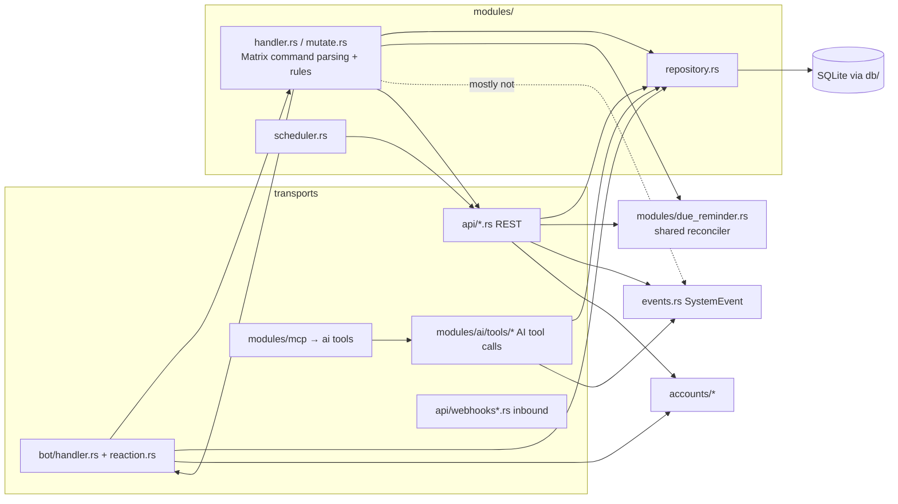

# Architecture Review

**Project:** matrix-hello-bot (`backend/` Rust crate `matrix-bot`, `frontend/` React SPA)
**Reviewed at:** commit `1138ef9` on `feat/web-ocr-voice-ai-tools`, 2026-09-18
**Scope:** structural architecture only. Product readiness, security hardening and UI craft were covered by
`docs/2026-09-09-ARCHITECTURE_REVIEW.md`, `docs/QA_PRODUCTION_READINESS.md` and `docs/PRODUCT_READINESS_REVIEW.md`;
this document does not repeat those findings.
**Deliverable:** an implementation-ready refactoring plan. No source was changed by this review.

---

## Executive Summary

The system is one Rust binary that runs a Matrix bot and an Axum REST API over a shared SQLite database, plus a
React SPA served by that same binary. Since the last review the crate has grown to roughly 61k lines
(about 21k of them tests) across 19 feature modules, and it now has **five independent entry paths that write the
same domain data**: REST handlers, Matrix `!commands`, Matrix emoji reactions, AI tool calls, and MCP tool calls
(which reuse the AI tool executor). Two more transports — inbound webhooks and the Telegram-compatible endpoint —
write the webhook outbox.

The codebase is well documented, well tested at the unit level, and its identity model (one `accounts` row owns
everything; Matrix and web sessions both resolve to it) is sound and should not be touched. The structural
problems are almost all consequences of one missing layer and one unenforced direction:

1. **There is no application/use-case layer.** The repository is the only thing shared between the five write
   paths, so validation limits, reminder reconciliation and SSE event emission are re-implemented — differently —
   in each transport. Concrete symptoms: `!todo add` never updates the web UI, a ✅ reaction on a task leaves its
   lead-time reminder pending, the AI tool path enforces no length limits, and the same constant is declared three
   times under two names.
2. **`modules/` depends on both transports.** Two feature modules import from `api/`, and the module contract
   (`CommandContext`) embeds Matrix SDK types. `api/rooms.rs` owns room-authorisation *writes* that a background
   worker in `modules/` calls.
3. **Boot-time composition is manual and partial.** `Config` is not reachable from the bot side, so the bot
   handler, the invite handler and the AI client re-read environment variables that `Config` already parsed.
   `ApiState` is hand-assembled with production-unsafe defaults that a later builder call must remember to override.
4. **One hand-maintained list is already wrong.** `accounts::OWNED_TABLES` names 20 tables; the schema has 23
   tables carrying `owner_id`. A merge therefore strands a user's public finance-share token, their portfolio
   audit chain, and their reaction targets on an account that the merge then deletes. Foreign keys are not enforced
   (no `PRAGMA foreign_keys`), so nothing catches it. The test that guards the list asserts its length, not its
   contents against the schema.

Four refactors address these root causes without a rewrite: (R1) derive `OWNED_TABLES` from the schema and make
the merge transactional; (R2) thread `Config` into the bot side and stop reading `env` elsewhere; (R3) add a
per-module `service.rs` that owns validate → write → reconcile → broadcast, starting with todo; (R4) move the two
misplaced `api/` functions into `modules/` and `db/`. Everything else in this document is either a smaller
follow-on or a quick win.

---

## Current Architecture

### What actually exists

```
main.rs
 ├─ Config::from_env()  ─────────────────────────────┐
 ├─ Database::connect() → db/schema::run_migrations  │  (only ApiState receives Config fields;
 ├─ EventBroadcaster (tokio::broadcast, process-wide)│   the bot side re-reads env)
 ├─ api::start_api_server(config, db, broadcaster) ──┘
 │     returns (bot_access_token, bot_client, pending_merges)  ← 3-tuple of Arc<RwLock<..>>
 │     Router: api/routes.rs → api/*.rs handlers → modules/*/repository.rs
 │             api/auth/extractor.rs (cookie | Bearer session | Bearer mb_mcp_ token)
 │             api/sse.rs (owner-filtered view of the broadcast channel)
 │             api/mcp.rs → modules/mcp/service.rs → modules/ai/tools/executor.rs
 └─ run_bot_loop(config, db, broadcaster, handles)  (reconnect w/ backoff)
       MatrixBot::new_full → bot/client.rs login → ModuleRegistry (17 BotModules)
       MatrixBot::run → bot/handler.rs::register_handlers
            ├─ bot/invite.rs        (re-reads MATRIX_VERIFICATION_ALLOWLIST)
            ├─ bot/reaction.rs      (emoji → TodoRepository / ReminderRepository directly)
            └─ message closure      (image → modules/ocr, audio → modules/voice,
                                     text → CommandParser → `!link` special case →
                                     resolve_or_provision → ModuleRegistry::dispatch)
       BackgroundWorkers guard: reminder, portfolio price, webhook outbox, briefing schedulers
       (each holds ModuleContext { client, db, broadcaster })

main.rs `mcp` subcommand: separate bootstrap, own DATABASE_URL read, stdio JSON-RPC → modules/mcp
```

### Layer map as found (not as intended)



The dotted edge and the two upward edges (`S → API`, `H → API/BOT`) are the structural defects. Everything else
is the shape the project's own `AGENTS.md` describes.

### Things that are right and load-bearing

- **Identity:** `accounts/` is the only owner. `resolve_or_provision` (Matrix) and the session extractor (web)
  both produce an `accounts.id`; `owner_id` is carried, never derived. Keep.
- **Events:** one `SystemEvent` enum, every variant has `owner_id()`, SSE filters per owner. Keep the shape.
- **Reminder reconciliation:** `modules/due_reminder.rs::sync` is a real shared application function — the one
  place where the "reconcile from current state" rule lives. It is the model the rest of this review asks the
  code to follow.
- **Worker lifetime:** `ModuleRegistry::spawn_all_background_workers` returns a `BackgroundWorkers` guard that
  aborts on drop, fixing the duplicate-scheduler-per-reconnect bug. Keep.
- **Transactions exist where money moves:** `modules/portfolio/trade.rs` wraps buy/sell/record in
  `pool.begin()`. Keep.
- **Route table drives tests:** `api/routes.rs::api_routes()` is used by the real server and by
  `api/mod.rs::step_up_tests`. Keep.

---

## Key Findings

### AR-001 — `OWNED_TABLES` is hand-maintained, already incomplete, and the merge that uses it is non-atomic

**Severity:** Critical

**Evidence:**
- `backend/src/accounts/mod.rs:59-80` — `OWNED_TABLES` lists 20 tables.
- `backend/src/db/schema_finance.rs` (`finance_shares`), `backend/src/db/schema_portfolio.rs`
  (`portfolio_audit_log`), `backend/src/db/schema_reactions.rs` (`bot_message_targets`) — three tables with an
  `owner_id` column that are **not** in the list. Total in schema: 23.
- `backend/src/accounts/merge.rs:153-175` — rewrites only `OWNED_TABLES`; `:192-193` re-points `matrix_links` and
  `webauthn_credentials` by `account_id`; `:222` deletes the absorbed account. `account_rooms` and `mcp_tokens`
  (both keyed by `account_id`) are not touched.
- `backend/src/db/pool.rs:36-39` — connect options set WAL and busy timeout; **no `foreign_keys(true)`**, so the
  `ON DELETE CASCADE` on `mcp_tokens` is inert and orphans are never rejected.
- `backend/src/accounts/mod.rs:186-206` — the guard test asserts `OWNED_TABLES.len() == 20` and that nine named
  tables are present. It cannot detect a table added to the schema and not to the list.
- `backend/src/accounts/merge.rs:14-20` — justifies having no transaction with "no repository in this project
  uses `pool.begin()`". That is no longer true: `modules/portfolio/trade.rs:28,182,294` and `db/rooms.rs:48` do.
- `backend/src/db/backfill.rs:46,147,452` — the one-shot backfill iterates the same constant, so the same three
  tables were skipped at backfill time for any legacy database.

**Current State:**
Ownership is a `TEXT owner_id` column on 23 tables. Two operations must visit all of them — the Phase-1 backfill
and account merge — and both walk a constant that a human updates by hand when adding a module. Three modules
(finance sharing, portfolio audit, reactions) added an `owner_id` table without updating it.

**Problem:**
After `!link` merges an unclaimed Matrix-provisioned account into a web account:
- the user's **public finance share token** (`finance_shares.owner_id`) still points at the deleted account, so
  `api/finance_analytics.rs::get_public_report` resolves the token to an owner with no rows — the share silently
  goes blank;
- the **portfolio audit hash chain** (`portfolio_audit_log`) is orphaned and disappears from the merged account;
- **reaction targets** (`bot_message_targets`) carry the dead owner, so `bot/reaction.rs::apply_reaction` calls
  `find_owned(pool, &target.owner_id, …)` against an account that no longer exists and every reaction on a
  pre-link message fails silently;
- `mcp_tokens` for the absorbed account survive with a dangling `account_id`; the extractor then answers
  "That account no longer exists" (a 401 with a misleading message);
- an interrupted merge leaves a partial rewrite. The code documents this as acceptable because each statement is
  idempotent, but the precedent it cites is gone and the operation is exactly what transactions are for.

**Root Cause:**
A list that must mirror the schema is maintained separately from the schema, and its test checks the list's
size instead of computing the expected set from the schema.

**Proposed Refactoring:**
1. Derive the expected set from SQLite itself in a test: after `run_migrations` on `sqlite::memory:`, query
   `sqlite_master` for every table and `PRAGMA table_info(<table>)` for an `owner_id` column; assert the resulting
   set equals `OWNED_TABLES` (both directions). This turns the drift into a compile-time-adjacent failure.
2. Add the three missing tables to `OWNED_TABLES` and to `MergePreview` (or fold them into `other`).
3. Add a second constant `ACCOUNT_ID_TABLES` (`matrix_links`, `webauthn_credentials`, `account_rooms`,
   `mcp_tokens`) with the same derived-set test, and have merge move `account_rooms` and **revoke** (not move)
   `mcp_tokens` and `sessions` — a credential belongs to the identity that minted it, exactly as the code already
   argues for sessions.
4. Wrap `MergeRepository::merge` in `pool.begin()`; commit after the account delete.
5. (Separate, optional, higher-risk) enable `foreign_keys(true)` in `db/pool.rs`. Evaluate first with
   `MIGRATE_TEST_DB=/tmp/copy.db cargo test migrates_a_real_database -- --ignored` on a copy: existing orphans
   do not fail on read, but any later write touching them will.

**Responsibility Changes:**
- `accounts/mod.rs` keeps the constants but they are now verified against `db/schema*`.
- `accounts/merge.rs` becomes the only place that knows how `account_id`-keyed tables behave on merge.

**Dependency Changes:** none. This is a correctness fix inside an existing boundary.

**Migration Steps:**
1. Write the derived-set test in `accounts/mod.rs` (it will fail, listing the three tables).
2. Extend `OWNED_TABLES`; extend `MergePreview::set`/`total` for the new names; run the test.
3. Add `ACCOUNT_ID_TABLES` + its test; implement move/revoke in `merge` for the two new tables.
4. Wrap the merge body in a transaction (`let mut tx = pool.begin().await?; … tx.commit().await?`), changing the
   inner `execute(pool)` calls to `execute(&mut *tx)`.
5. Run `cargo test --package matrix-bot accounts::merge` and the real-database migration test on a copy.
6. Delete the stale paragraph in `merge.rs:14-20` and the matching sentence in `CLAUDE.md` ("no repository in
   this codebase uses `pool.begin()`").

**Risk:**
- Behaviour change: merges now move three more tables. That is the intended fix; there is no user-visible
  regression path.
- Data migration: none. Existing stranded rows from past merges are not repaired by this change; a one-off
  `UPDATE … WHERE owner_id NOT IN (SELECT id FROM accounts)` cannot know the destination, so leave them.
- Concurrency: the transaction shortens the window in which a concurrent request sees half a merge. SQLite WAL +
  busy timeout of 5s covers the lock.
- Test risk: low; the new test is deterministic.

**Validation:** new derived-set tests pass; existing `merge.rs` tests pass; `migrates_a_real_database` on a copy
reports nothing stranded; `cargo test` green.

---

### AR-002 — Domain write rules live in transports; five entry paths re-implement them inconsistently

**Severity:** Critical

**Evidence (todo, the clearest case):**
- `backend/src/api/todos.rs:193-199` — 500-char limit as a literal; `:92-104` `validate_lead`; `:81-89`
  `reminder_room`; `:252-259` calls `due_reminder::sync(…, Some(&state.broadcaster), …)`.
- `backend/src/modules/todo/mutate.rs:12-14` — `MAX_TASK_TEXT_LEN = 500` and `MAX_ROOM_TASKS = 500` (the room cap
  exists **only** on the Matrix path); `:126, :248, :313, :386` call `due_reminder::sync`/`tear_down` with
  `None` for the broadcaster.
- `backend/src/modules/todo/mod.rs:85` — `_broadcaster: Option<&EventBroadcaster>` is discarded; the same in
  `modules/finance/mod.rs:79`, `modules/reminder/mod.rs:57`. Result: `!todo add`, `!expense add`, `!remind`
  never reach the web UI's live stream, contradicting `AGENTS.md` §2 and the trait's own doc comment
  (`modules/mod.rs:157-161`).
- `backend/src/modules/ai/tools/todo.rs:60-104` — `add_todo` applies **no** text-length check, no lead-time
  bound, no due-date precondition, and does not call `due_reminder::sync` at all, so a todo created by the AI
  with `remind_before_minutes` never gets its reminder row. `:136-147` `complete_todo` likewise skips the
  reconciler.
- `backend/src/bot/reaction.rs:193` — ✅ on a task calls `TodoRepository::set_completed` directly; the only
  `due_reminder` reference in the file is the delay path (`:325`). Completing via reaction leaves the lead-time
  reminder pending, and it fires later for a finished task.
- `backend/src/modules/mcp/adapter.rs:39` — MCP delegates to `ai::tools::executor::execute`, so it inherits every
  AI-tool gap above.

**Evidence (same pattern elsewhere):**
- finance: `api/finance.rs:17-18` (`MAX_NOTE_LEN`, `MAX_CATEGORY_LEN = 64`) vs `modules/finance/handler.rs:12`
  (`MAX_NOTE_LEN` again) and `:397` (literal `64`); `modules/ai/tools/finance.rs:237` creates transactions with
  no note-length check.
- AI: `modules/ai/handler.rs:22` `MAX_PROMPT_LENGTH = 4000` vs `api/ai.rs:37` literal `4000`.
- portfolio: `api/portfolio.rs:107-190`, `modules/portfolio/trade_cmd.rs:90`, `modules/ai/tools/portfolio/mod.rs:140`
  each normalise the symbol, parse amounts, call `buy`/`buy_at`, map `BuyOutcome`, and emit `cash_event`.
- Errors are stringly typed at the seams: `run_ai_turn` returns `Result<_, String>` and `api/ai.rs:64-67` maps
  *every* failure to `400 Bad Request`, including timeouts and provider errors; tool executors return
  `Result<String, String>`.

**Current State:**
```
REST handler ─┐
Matrix handler ├─► Repository ─► SQLite
Reaction ─────┤        ▲
AI tool ──────┤        │ (due_reminder::sync is called from some of these, with or without a broadcaster)
MCP ──────────┘
```
Each arrow re-implements: input validation, ownership lookup, reminder reconciliation, `SystemEvent` emission, and
error shaping — with a different subset each time.

**Problem:**
Every new rule (a limit, a side effect, an event) has to be added in up to five places, and the evidence shows it
is not. The inconsistencies are user-visible today (stale web UI after a Matrix command; orphan reminders after a
reaction; unbounded input over AI/MCP). Tests exist per transport, so none of them can assert parity.

**Root Cause:**
The repository is the only shared layer, and repositories are (correctly) dumb. There is no function that means
"create a todo for this owner" independent of how the request arrived. `modules/due_reminder.rs` is the one
exception and shows the shape that works.

**Proposed Refactoring:**
Add a **plain-function service layer per module** — no trait, no DI container:

```
backend/src/modules/todo/service.rs
  pub struct NewTodo<'a> { text: &'a str, priority: TodoPriority, due_at: Option<DateTime<Utc>>,
                           remind_before_minutes: Option<i64>, room_id: &'a str,
                           remind_room_id: Option<&'a str>, sender_name: &'a str }
  pub enum TodoError { Invalid(String), NotFound, Db(anyhow::Error) }
  pub async fn create(pool, broadcaster: Option<&EventBroadcaster>, owner_id: &str, input: NewTodo)
        -> Result<TodoItem, TodoError>
  pub async fn complete(pool, broadcaster, owner_id, id, completed: bool) -> Result<TodoItem, TodoError>
  pub async fn update(pool, broadcaster, owner_id, id, patch: TodoPatch) -> Result<TodoItem, TodoError>
  pub async fn delete(pool, broadcaster, owner_id, id) -> Result<(), TodoError>
```
Each function owns, in order: validate (one set of constants, moved here from `mutate.rs`) → repository write →
`due_reminder::sync`/`tear_down` → `broadcaster.send`. Transports become thin adapters:

- `api/todos.rs` maps request → `NewTodo`, `TodoError` → `ApiError` (one `impl From<TodoError> for ApiError`).
- `modules/todo/mutate.rs` maps `!todo add …` → `NewTodo` and `TodoError` → HTML.
- `modules/ai/tools/todo.rs` maps JSON args → `NewTodo` and `TodoError` → tool string.
- `bot/reaction.rs::handle_done` calls `service::complete`.

Repeat for finance (`FinanceError`), portfolio (wrap the existing `trade::*` calls plus symbol/currency
normalisation and `cash_event`), reminder, and recurring bills. Modules whose Matrix handler already threads the
broadcaster (portfolio, bills, settings) mostly need the validation consolidation.

**Responsibility Changes:**
| Responsibility | Today | After |
| --- | --- | --- |
| Input limits (`MAX_*`) | `api/*.rs`, `modules/*/handler.rs`, literals | `modules/<m>/service.rs` (single owner) |
| Reminder reconciliation calls | 3 of 5 paths | service only |
| `SystemEvent` emission | REST + AI + some Matrix | service only |
| Ownership check (`find_owned`) | each transport | service |
| Error classification | `String` / per-transport | `<Module>Error` enum |

**Dependency Changes:**
```
Current:                          Proposed:
api/todos.rs → todo/repository    api/todos.rs → todo/service → todo/repository
todo/mutate.rs → todo/repository  todo/mutate.rs → todo/service
ai/tools/todo.rs → todo/repository ai/tools/todo.rs → todo/service
bot/reaction.rs → todo/repository bot/reaction.rs → todo/service
(all four) → due_reminder         todo/service → due_reminder
(some) → events                   todo/service → events
```

**Migration Steps (todo first; it is the one with the reminder coupling):**
1. Create `modules/todo/service.rs` with `create` only, moving `MAX_TASK_TEXT_LEN`/`MAX_ROOM_TASKS` and the
   REST `validate_lead`/`reminder_room` logic into it. Decide the room cap explicitly: keep it (and apply it to
   REST/AI too) or drop it — it is a product decision hidden in the Matrix path today; recommend keeping it and
   applying it everywhere.
2. Port `api/todos.rs::create_todo` to call `service::create`; keep its tests (they drive the handler and still
   pass). Add `impl From<TodoError> for ApiError`.
3. Port `modules/todo/mutate.rs::handle_add`; change `TodoModule::handle_command` to pass the broadcaster through
   to `handle_todo_command` and on to `mutate.rs`. Remove the `None` literals.
4. Port `modules/ai/tools/todo.rs` `add_todo` to `service::create` (this is where the missing validation and
   reminder sync land for free).
5. Add `service::complete`, `update`, `delete`; port the remaining REST/Matrix/AI/reaction call sites.
6. Add a **parity test** in `service.rs`: a table of inputs that must be rejected, run once — the transports
   no longer have their own validation to test. Keep one smoke test per transport that a rejection surfaces
   correctly in that transport's format.
7. Repeat steps 1–6 for finance, then portfolio (after AR-007 collapses the facade), then reminder and bills.
8. Replace `Result<_, String>` in `modules/ai/handler.rs::run_ai_turn` with an `AiError` enum
   (`Validation`, `Provider`, `Timeout`, `Db`) so `api/ai.rs` can return 400/502/504 instead of 400 for all.

**Risk:**
- Behaviour change: intended, and each is a bug fix (web UI updates from Matrix; reminders reconciled from
  reactions and AI; limits enforced over AI/MCP). Call them out in the changelog: AI/MCP callers will now get
  validation errors they previously did not.
- Matrix reply wording must be preserved — the HTML formatting stays in `mutate.rs`; only the decision moves.
- Concurrency: none new; the service is stateless.
- Test risk: medium volume, low difficulty. Handler tests in `api/todos.rs` (≈30) and `modules/todo/*` continue to
  compile because signatures at the handler level are unchanged.

**Validation:** existing per-transport tests; new parity test; `frontend/e2e/live-updates.spec.ts` and
`todo-due-reminder.spec.ts` against the fake API remain green; manual check that `!todo add` now shows up in an
open browser tab.

---

### AR-003 — `modules/` depends on both transports; two `api/` functions own logic that modules need

**Severity:** High

**Evidence:**
- `backend/src/modules/journal/handler.rs:5` — `use crate::api::life_activity::collect_day_activity;` a Matrix
  command handler importing a REST module to render a day's activity.
- `backend/src/modules/webhook/scheduler.rs:45` — a background worker calls
  `crate::api::rooms::is_room_authorized_for_account`, which (`api/rooms.rs:152-200`) reads and **writes**
  `account_rooms`. `AGENTS.md` §4 states room resolution must live in `db/rooms.rs` precisely to avoid this.
- `backend/src/api/rooms.rs:85-150` — `discover_rooms_for_account` is likewise a repository-shaped function living
  in the API layer.
- `backend/src/modules/mod.rs:55, 117, 119` — the module contract embeds `bot::quote::QuotedMessage` and
  `bot::stage::StageReporter` (which holds a `matrix_sdk::room::Room`, `bot/stage.rs:71-74`).
- `backend/src/modules/reminder/scheduler.rs:77,114` and `modules/ai/handler.rs:378` — write
  `bot_message_targets` through `bot/reaction_targets.rs::record_target`/`record_ai_tool_target`, which are
  repository functions sitting in the transport directory.
- `backend/src/modules/portfolio/scheduler.rs:6`, `modules/account/mod.rs:23` — `bot::notify` (acceptable: a
  worker holding `ModuleContext.client` sending a DM is a Matrix concern by nature).

**Current State:** `modules` → `api` (2 edges), `modules` → `bot` (≈12 edges, 3 of them for DB access).

**Problem:**
The layer that is supposed to be transport-agnostic cannot be compiled, tested, or reasoned about without both
transports. `is_room_authorized_for_account` performing an `INSERT OR IGNORE` from inside an HTTP module means
the cache-population rule is invisible to anyone reading `db/rooms.rs`. It also blocks AR-002: a service in
`modules/` cannot own "which room may I deliver to" while that rule lives in `api/`.

**Root Cause:**
Direction was never enforced; each function was placed where it was first needed.

**Proposed Refactoring:**
1. Move `api/life_activity.rs::collect_day_activity` and all of `api/life_activity_collectors.rs` to
   `modules/life/activity.rs`. `api/life_activity.rs` keeps only `get_day_activity` (the handler) and the response
   DTOs.
2. Move `is_room_authorized_for_account` and `discover_rooms_for_account` into `db/rooms.rs::RoomRepository`.
   `api/rooms.rs` keeps `list_rooms` / `sync_rooms` handlers. While there, delete the free-function wrappers at
   `db/rooms.rs:188-215` that duplicate the `RoomRepository` methods (see AR-011).
3. Move the DB functions of `bot/reaction_targets.rs` (`record_target`, `get_target`, `delete_target_by_entity`,
   `record_ai_tool_target`, `copy_targets`, `link_turn_targets`) into `db/message_targets.rs` (or
   `modules/reactions/repository.rs`). Leave HTML/event parsing (`parse_entity_from_reply`,
   `resolve_untracked_target`, `try_record_from_reply`) in `bot/`.
4. Move `QuotedMessage` and `extract_quote_and_prompt` (pure parsing) to `modules/quote.rs`; keep
   `resolve_quoted_event_from_room` in `bot/quote.rs`. `StageReporter` is deliberately **left** in `bot/`: it is
   already `Option` with a `noop()` and is the one accepted Matrix concept in the contract. Do not abstract it.
5. Add a unit test in `modules/mod.rs` that fails on any `use crate::api` inside `modules/` (a `#[test]` that
   walks `src/modules/**/*.rs` with `std::fs` and asserts no non-comment line contains `crate::api`). Cheap and
   permanent.

**Responsibility Changes:**
- `db/rooms.rs` owns every read and write of `account_rooms`.
- `modules/life` owns activity collection; `api/life_activity.rs` only serialises it.
- `bot/` owns Matrix I/O; DB access for reaction targets moves next to the other repositories.

**Dependency Changes:**
```
Current:                                       Proposed:
modules/journal → api/life_activity            modules/journal → modules/life/activity
modules/webhook/scheduler → api/rooms          modules/webhook/scheduler → db/rooms
modules/reminder/scheduler → bot/reaction_targets   → db/message_targets
modules/ai/handler → bot/reaction_targets           → db/message_targets
api/rooms → (its own DB code)                  api/rooms → db/rooms
```

**Migration Steps:** pure moves; do 1, 2, 3, 4 as four separate commits each followed by `cargo check` and
`cargo test`. Update `AGENTS.md` §2's file list. Add the direction test last.

**Risk:** near zero behaviour risk (moves, not rewrites). Test risk: tests move with their functions. The only
subtlety is `api/rooms.rs` tests that construct an `ApiState`; they stay with the handlers.

**Validation:** `cargo check` warning-free; `cargo test`; the new direction test.

---

### AR-004 — Configuration is read ad hoc in 30+ places because `Config` never reaches the bot side

**Severity:** High

**Evidence:**
- `backend/src/config.rs` already parses `ocr_enabled`, `ocr_model_dir`, `voice_enabled`, `voice_model_dir`,
  `voice_language`, `verification_allowlist`.
- `backend/src/bot/handler.rs:134-137, 250-260` — re-reads `OCR_MODEL_DIR`, `VOICE_ENABLED`, `VOICE_MODEL_DIR`,
  `VOICE_LANGUAGE` from `env` inside the message closure.
- `backend/src/bot/invite.rs:16-21` — re-parses `MATRIX_VERIFICATION_ALLOWLIST`.
- `backend/src/modules/ai/client.rs:39-52, 119-125, 518-520`, `modules/ai/search.rs:93, 126-130`,
  `modules/ai/models.rs:68` — about 20 `env::var` reads with fallback chains (`AI_ENDPOINT` → `AI_API_BASE` →
  … → `OPENAI_BASE_URL`), evaluated lazily and, for `client.rs:469`, frozen into a process-global `OnceLock`.
- `backend/src/api/auth/recovery.rs:46` — `TRUST_FORWARDED_FOR`.
- `backend/src/main.rs:106-128` — the `mcp` subcommand re-derives `DATABASE_URL` with its own default and, when
  no `--owner` is given, **silently selects the oldest account** as the MCP principal.
- `backend/src/bot/mod.rs:51-58` — `MatrixBot::new_full` receives `&Config` but `run()` and
  `register_handlers` (`bot/handler.rs:18-24`) do not; `ModuleContext` (`modules/mod.rs:124-132`) carries
  `client, db, broadcaster` only.

**Problem:**
Two sources of truth for the same setting (bot vs API) can disagree; `Config::validate` cannot validate what it
does not own; tests cannot inject configuration for the bot path without mutating process environment; the MCP
default-owner rule is a security-relevant policy hidden in `main.rs`.

**Root Cause:** `Config` was designed for the API server; the bot side grew features (OCR, voice, AI) that
each read what they needed at the point of use.

**Proposed Refactoring:**
1. Add to `Config`: `trust_forwarded_for: bool`, and an `ai: AiEnvConfig { base_url, api_key, model, proxy,
   tavily_api_key, allow_private_base_url }` built once with the existing fallback chains
   (`modules/ai/client.rs:39-52` moves here verbatim). `ResolvedAiConfig::from_user_config` takes
   `&AiEnvConfig` instead of reading env.
2. Add `config: Arc<Config>` to `ModuleContext` and pass `&Config` to `register_handlers`. `bot/handler.rs`
   builds `OcrConfig`/`VoiceConfig` from it; `bot/invite.rs` takes the allowlist as a parameter.
3. `main.rs` `mcp` mode: call a new `Config::database_url_from_env()` (one function, shared default) and
   **require** `--owner`; remove the oldest-account fallback. Document the flag in `docs/MCP_SERVER.md`.
4. Add a test that walks `backend/src` for `env::var(` outside `config.rs` and the `#[ignore]`d live tests, and
   fails on new occurrences (same mechanism as the AR-003 direction test).

**Responsibility Changes:** `config.rs` is the only reader of process environment. Everything else receives
values.

**Dependency Changes:**
```
Current:  bot/handler.rs → std::env ; modules/ai/client.rs → std::env ; api/auth/recovery.rs → std::env
Proposed: main.rs → Config → {api::ApiState, bot::ModuleContext} → handlers/modules
```

**Migration Steps:**
1. Extend `Config` (+ tests in `config.rs` for the AI fallback chain — port the ones in `client.rs`).
2. Thread `Arc<Config>` into `MatrixBot`, `register_handlers`, `ModuleContext`. Replace the four `env::var`
   reads in `bot/handler.rs` and the one in `bot/invite.rs`.
3. Port `modules/ai/{client,search,models}.rs` to take `&AiEnvConfig`. The `OnceLock<AiClient>` global can stay
   but must be initialised from `Config` at boot (`AiClient::init(&config.ai)`), not lazily from env.
4. `api/auth/recovery.rs` reads `state.trust_forwarded_for`.
5. `main.rs` MCP path.
6. Add the guard test.

**Risk:**
- Behaviour: none if the fallback chains are moved verbatim. The MCP `--owner` requirement is a deliberate
  breaking change for anyone relying on the implicit default — call it out.
- Test risk: tests in `modules/ai` that set env vars will need to construct `AiEnvConfig` directly (an
  improvement).

**Validation:** `cargo test`; boot the bot with `OCR_ENABLED=false` and confirm both the REST dropzone and the
Matrix image path refuse consistently; guard test green.

---

### AR-005 — `bot/handler.rs` is one 450-line event closure with two copy-pasted media pipelines

**Severity:** High

**Evidence:**
- `backend/src/bot/handler.rs:17-485` — a single `register_handlers` whose message closure spans lines 37–484.
- `:60-198` (image) and `:200-330` (audio) are structurally identical: mention check → `TypingGuard` →
  `StageIndicator::start` → `resolve_or_provision` (error text duplicated) → `download_media_file` (two error
  branches duplicated) → build config from env → `catch_unwind` around the module call → `finish_with_reply` →
  `link_turn_targets`. Only the module function, the labels, and the config differ.
- `:344-360` — the "any DM text is an AI prompt" rule constructs a synthetic `ParsedCommand { command: "ai" }`
  inline; the dispatcher (`bot/dispatcher.rs::CommandParser`) does not know this rule exists.
- `:373-385` — the `!link` special case is dispatched here (correctly, and documented as load-bearing), but it
  sits between two other concerns.
- File is 485 production lines against the project's own 500-line rule (`AGENTS.md` §3), with zero tests in
  the file (all behaviour is only reachable through a live Matrix client).

**Problem:** Any change to the attachment flow (a new error message, a new stage label, a new media type such as
PDF receipts) must be made twice, and the file cannot be unit tested. After AR-004 removes the env reads the
shape is still the same.

**Root Cause:** Feature growth (OCR, then voice, then AI-in-DM) was appended to the one closure that had the
`Room` and `Client` in scope.

**Proposed Refactoring:**
```
bot/handler.rs        register_handlers only: invite, reaction, message → route by MessageType
bot/attachments.rs    enum Attachment { Image(ImageMessageEventContent), Audio(AudioMessageEventContent) }
                      async fn handle_attachment(ctx: &AttachmentCtx, room, ev, attachment) — one body,
                      labels/config/module fn selected by a small match at the top
bot/command_flow.rs   async fn handle_text(ctx, room, ev): parse (incl. DM→AI fallback moved into
                      CommandParser::parse_or_dm_prompt), `!link` gate, resolve owner, dispatch, reply, record targets
bot/reply.rs          fn send_html(room, html) -> Option<OwnedEventId> (the text_html + strip_html + send + log
                      sequence appears 5 times across handler.rs/reaction.rs/linking)
```
Error strings (currently inline Chinese HTML literals) become constants in one place so both paths share them.

**Responsibility Changes:** `CommandParser` owns every rule for "is this message a command"; `attachments.rs`
owns the media pipeline once; `handler.rs` only wires.

**Dependency Changes:** none across layers; intra-`bot/` only.

**Migration Steps:**
1. Extract `bot/reply.rs::send_html` and use it from handler/reaction/linking (pure refactor).
2. Extract `handle_attachment` from the image branch; make the audio branch call it; delete the duplicate.
3. Move the DM→AI rule into `CommandParser` with a unit test (`dispatcher.rs` already has tests).
4. Extract `handle_text`; `register_handlers` becomes ~60 lines.
5. Unit-test `handle_attachment`'s pre-download decisions (mention gating) with a fake `Attachment`.

**Risk:** behaviour must be byte-identical for replies; keep the strings. Depends on AR-004 for the config source
(do AR-004 first or pass the env-derived config through the new signature in the interim).

**Validation:** `cargo check`; manual: send an image, a voice note, a `!todo`, and a plain DM to the bot — each
still answers as before; `cargo test --package matrix-bot bot::`.

---

### AR-006 — `ApiState` is hand-assembled with unsafe defaults; bot handles travel as an anonymous 3-tuple

**Severity:** Medium

**Evidence:**
- `backend/src/api/auth/types.rs:156-185` — `ApiState::new` sets `registration_open: true`, a `localhost`
  WebAuthn RP, `cookie_secure: false`; `start_api_server` (`api/mod.rs:69-108`) must then remember to call
  `.with_registration_open(..)`, `.with_ocr_and_voice(..)`, `.with_webauthn(..)`. A forgotten builder call ships
  open registration on a localhost RP.
- `backend/src/api/mod.rs:59-68` — returns `(Arc<RwLock<Option<String>>>, Arc<RwLock<Option<Client>>>,
  Arc<PendingMerges>)`; `main.rs:28-30` and `bot/mod.rs:51-58` accept them as three/six positional `Option`
  parameters; `bot/mod.rs:100,103` does `client_handle.clone().unwrap_or_default()` for modules that need it.
- `ApiState` has 15 fields spanning HTTP config, WebAuthn ceremonies, bot handles, OCR/voice config.

**Problem:** Composition is spread across `main.rs`, `api/mod.rs` and `bot/mod.rs` with `Option`s that are
`None` only in tests; the production wiring is not type-checked. Adding a config value means touching four
files.

**Root Cause:** `ApiState::new` doubles as the test constructor, so production-only fields got defaults.

**Proposed Refactoring:**
1. `bot/handles.rs`: `#[derive(Clone, Default)] pub struct BotHandles { access_token, client, pending_merges }`
   created once in `main.rs`, passed to both `start_api_server` and `run_bot_loop`. `MatrixBot::new_full`
   takes `BotHandles` (not three `Option`s). Modules that need the client take `handles.client.clone()`.
2. `ApiState::from_config(config: &Config, db, broadcaster, handles: BotHandles) -> anyhow::Result<Self>` as the
   **only** non-test constructor; the builder methods and `new` become `#[cfg(test)] pub fn for_tests(db)`.
3. Group the 15 fields: `pub auth: AuthConfig { webauthn, webauthn_origin, cookie_secure, registration_* }`,
   `pub bot: BotHandles`, `pub media: MediaConfig { ocr, voice }`. Field access sites change mechanically.

**Responsibility Changes:** `main.rs` composes; `api/` and `bot/` consume a typed bundle.

**Dependency Changes:** `api/mod.rs` no longer returns bot state; `main.rs → BotHandles → {api, bot}`.

**Migration Steps:** (1) add `BotHandles` and use it in `main.rs`/`bot/mod.rs` (2) add `from_config` and switch
`start_api_server` to it (3) mark `new`/builders `#[cfg(test)]`, rename to `for_tests` (4) group fields last, as
a mechanical rename commit.

**Risk:** low; compile errors guide every site. ~40 test call sites of `ApiState::new` become `for_tests`.

**Validation:** `cargo test`; `api/mod.rs::step_up_tests` still drives the real router; boot in
`ENVIRONMENT=production` with localhost RP still refuses (that check lives in `Config::validate`, unchanged).

---

### AR-007 — Portfolio persistence is two stacked facades with every signature doubled

**Severity:** Medium

**Evidence:**
- `backend/src/modules/portfolio/repository.rs:178-232` — `buy` → `buy_at` → `trade::buy_at`; `:56-160` cash
  methods each forward to `cash_repo::*`; `:317-352` `sell`/`sell_at` → `trade::sell_at`; `:230-315`
  `record_holding`/`record_holding_at`/`record_holding_action`. 468 production lines, the majority forwarding.
- `backend/src/modules/portfolio/trade.rs` and `cash_repo.rs` hold the real (transactional) bodies.
- Callers mix levels: `api/portfolio.rs:124` calls `buy_at`, `trade_cmd.rs:90` and `ai/tools/portfolio/mod.rs:140`
  call `buy`.
- `CLAUDE.md` ("Neither table write is wrapped in an explicit DB transaction — no repository in this codebase uses
  `pool.begin()`") is stale; `trade.rs:28` does.

**Problem:** Three layers exist where one does; each new operation is written three times (`x`, `x_at`,
`trade::x_at`). It also blocks the portfolio service in AR-002 from being small.

**Proposed Refactoring:** keep `trade.rs` and `cash_repo.rs` as the repository (they already are); make
`PortfolioRepository` hold only the read side (`find`, `find_owned`, `list`, `summary`, `set_price`, `set_note`,
`update_symbol`, `delete`) and delete the forwarding pairs. Callers use `trade::buy_at(…, executed_at: None)`
directly; the service from AR-002 wraps them once. Update `CLAUDE.md`.

**Migration Steps:** delete one forwarding pair at a time, fix call sites (≈8), run
`cargo test --package matrix-bot modules::portfolio::`.

**Risk:** none functional (pure forwarding). Test risk: repository tests that call `PortfolioRepository::buy`
move to `trade.rs` or call `buy_at`.

---

### AR-008 — Frontend contract drift: unannotated handlers → hand-written types; duplicated nav list; ad hoc event bus

**Severity:** Medium

**Evidence:**
- `backend/src/api/{footprints,habits,life,life_activity,webhooks_telegram}.rs` — **zero** `#[utoipa::path]`
  annotations, so these endpoints are absent from `openapi.json` and from `frontend/src/types/api.ts`.
- `frontend/src/modules/*/types.ts` — 9 modules declare their own DTOs; only `bookmarks/types.ts` imports
  `types/api`. `frontend/src/modules/todo/index.tsx:30` hand-declares `TodoItem` although the generated
  `components['schemas']['TodoItem']` exists (`types/api.ts:2403`).
- `frontend/src/components/Sidebar.tsx:39-67` — a hard-coded list of module ids, labels, icons and groups that
  parallels the `registry` populated in `App.tsx:31-35`; `FrontendModule` already has `name`/`iconName`/`navTab`.
- `frontend/src/App.tsx:85-100` — module navigation via `window.dispatchEvent(new CustomEvent('app:navigate'))`
  and `'app:ai-prompt'`; no router.
- `frontend/src/modules/feed/` — empty directory.
- Backend `modules/journal` writes `life_day_logs` through `LifeRepository` (`journal/handler.rs:230,288`) — a
  second `BotModule` over the same aggregate as `modules/life` (`life/handler.rs:181`). The frontend mirrors this
  with `mood` and `time_blocks` modules that both call `/life/days*` (`mood/index.tsx:128`,
  `time_blocks/index.tsx:84`), so there are four names for one domain.

**Problem:** Types drift silently (a backend field rename compiles on both sides and fails at runtime); the
OpenAPI CI check (`.github/workflows/ci.yml` diffs `openapi.json`) cannot protect endpoints that are not in the
spec; nav metadata is maintained twice.

**Root Cause:** The generated-types pipeline was added after most modules existed and the annotation step is
optional per handler.

**Proposed Refactoring:**
1. Annotate the five unannotated API files and register them in `api/openapi.rs::ApiDoc`; regenerate both
   artifacts. Add a test in `api/openapi.rs` that every route in `api_routes()` appears in the generated document
   (Axum does not expose routes, so keep the list in `routes.rs` as `pub const ROUTE_PATHS` and test that the
   document's `paths` and the constant agree).
2. Migrate module `types.ts` files to `export type TodoItem = components['schemas']['TodoItem']`; delete the
   hand-written shapes one module at a time; `npm run build` is the check.
3. Add `group: 'productivity' | 'money' | 'life' | 'system'` and `order` to `FrontendModule`; build the Sidebar
   from `registry.getAll()`; delete the literal list.
4. Replace the `window` custom events with a `navigate(moduleId)` function exported from a small
   `core/navigation.ts` store (`useSyncExternalStore` singleton). A hash router is a larger, separate product
   decision — not proposed here.
5. Backend: fold `modules/journal` into `modules/life` as `life/journal_cmd.rs` (same `BotModule`, keep the
   `!journal`/`!daily`/`!log` command words). Frontend naming (`mood`, `time_blocks`) is a product choice; leave
   it but document in `AGENTS.md` that both are views over `life`.
6. Delete `frontend/src/modules/feed/`.

**Risk:** type migration may surface real mismatches (that is the point); fix on the backend when the frontend
was right, in the DTO when the backend was right. No runtime behaviour change otherwise.

**Validation:** `cargo run --bin generate-openapi` + `npm --prefix frontend run generate-api` + `npm run build`;
Playwright suite (`frontend/e2e`) against the fake API; CI's openapi diff.

---

### AR-009 — The auth extractor grew a second credential kind inline; documentation contradicts the code

**Severity:** Medium

**Evidence:**
- `backend/src/api/auth/extractor.rs:37-60` — Bearer parsing; `:91-125` — an `mb_mcp_` branch that resolves an
  MCP token, spawns a `touch_last_used` task, loads the account, and constructs `AuthUser` — all inside
  `from_request_parts`.
- `README.md:84-101, 209` documents Bearer session tokens and the Origin exemption. `CLAUDE.md` ("There is no
  password, no bearer token, and no JWT"; "no bearer-token client remains") is wrong on the current tree.
- `backend/src/api/auth/types.rs:308-314` — `SseTicketResponse` has no remaining producer (`api/sse.rs:96` explains
  the ticket mechanism was removed).
- `backend/src/db/schema_auth.rs:242-253` — `web_users` (with `password_hash`) is still created on every boot; its
  only readers are the legacy backfill (`db/backfill.rs:61,91`) and a pool test.

**Problem:** Authentication policy for three credential kinds (cookie session, bearer session, MCP token) is
interleaved in one 140-line function. The MCP branch sets `last_verified_at = created_at`, which means an MCP
token can satisfy `VerifiedUser` for the first five minutes of its life and never again — an accidental
property, not a stated or tested one.

**Proposed Refactoring:**
1. `accounts/principal.rs`: `pub enum Credential<'a> { Cookie(&'a str), BearerSession(&'a str), McpToken(&'a str) }`
   with `Credential::parse(headers)`; `pub async fn resolve(pool, cred) -> Result<Option<AuthUser>, anyhow::Error>`
   containing the session and MCP branches. The extractor becomes: parse → CSRF check if cookie → resolve → 401
   mapping.
2. State the step-up rule for MCP tokens explicitly (an MCP token should never satisfy `VerifiedUser`; set
   `last_verified_at` to the epoch) with a test in `api/mod.rs::step_up_tests`.
3. Delete `SseTicketResponse`. Keep `web_users` DDL only while `backfill` needs it; add a comment naming the
   backfill as its sole reason to exist.
4. Rewrite the CLAUDE.md "Auth" paragraph to match README.

**Risk:** the MCP step-up change is a deliberate tightening; nothing else is functional. The extractor tests in
`api/auth/mod.rs` pin the rest.

---

### AR-010 — Error mapping boilerplate ignores the `From` impls that already exist

**Severity:** Low (quick win; subsumed by AR-002's error enums)

**Evidence:** 116 occurrences of `.map_err(|e| ApiError::internal(e.to_string()))` under `backend/src/api/`,
while `error.rs:98-108` implements `From<sqlx::Error>` and `From<anyhow::Error>` for `ApiError`, so `?` alone
would do the same thing.

**Proposed:** mechanical replacement with `?` (repositories return `anyhow::Result`). Do this per file as part of
touching it for AR-002; do not do it as a standalone sweep across files that AR-002 will rewrite anyway.

---

### AR-011 — Small duplications and oversize files that indicate the same root causes

**Severity:** Low

- `backend/src/db/rooms.rs:188-215` — free functions that just call `RoomRepository::*`; delete one form
  (part of AR-003 step 2).
- `backend/src/modules/ai/handler.rs:33-64` and `:149-167` — `handle_ai_command` / `run_ai_turn` are pure
  forwarders to their `_with_stage` twins that already take `Option`. Delete the forwarders; pass `None`.
  `handle_ai_command_with_stage` takes 13 positional parameters that are all fields of `CommandContext`; take
  `&CommandContext`. File is 531 production lines (rule: 500).
- `modules/ai/tools/executor.rs:51-112` — a ten-arm "try each module" chain; after AR-002 each module's service
  exposes its tools, so this can become a `HashMap<&str, ToolFn>` built from `definitions.rs`. Not urgent.
- Process globals (`OnceLock` HTTP clients in `price_feed.rs`, `history_feed.rs`, `ai/client.rs`;
  `webhook/scheduler.rs::OUTBOX_NOTIFY`; `ai/alert.rs::AI_ERROR_ALERTED`; `finance/fx.rs::FX_CACHE`): acceptable
  for a single-process binary, but `OUTBOX_NOTIFY` and `AI_ERROR_ALERTED` leak across tests in the same process.
  Note only; move into `ModuleContext` if a flaky test ever appears.

---

## Cross-Cutting Architectural Issues

| Root cause | Findings | One-line fix |
| --- | --- | --- |
| **RC-A: No application boundary.** The repository is the only shared layer; each transport re-implements rules. | AR-002, AR-010, AR-011 (ai handler) | Per-module `service.rs` with plain functions and a typed error enum. |
| **RC-B: Layer direction not enforced.** `api/` and `bot/` each became "where things live". | AR-003, AR-005, AR-009 | Move the misplaced functions; add two directory-walking tests (no `crate::api` in modules, no `env::var` outside config). |
| **RC-C: Composition is manual and partial.** `Config` stops at `ApiState`; bot side self-serves from env; `ApiState::new` has production defaults. | AR-004, AR-006 | Thread `Arc<Config>` and a `BotHandles` struct from `main.rs` into both halves; a single `from_config`. |
| **RC-D: Hand-maintained mirrors of another source.** Lists that must match the schema, the route table, or the module registry. | AR-001 (`OWNED_TABLES`), AR-008 (openapi paths, Sidebar, DTOs), `modules/mod.rs:320` (dispatch-order test list) | Derive at test time and assert equality; where derivation is impossible, keep one list and generate the others. |

---

## Refactoring Dependency Graph

```text
R1  AR-001  Derive OWNED_TABLES, transactional merge            (independent — do first)
R2  AR-004  Config threaded into bot; env reads removed         (independent)
R3  AR-003  Move api→modules/db misplaced functions             (independent)
R4  AR-006  BotHandles + ApiState::from_config                  ← R2
R5  AR-007  Collapse portfolio facade                           (independent)
R6  AR-002a todo service (validate→write→sync→broadcast)        ← R3 (message-target repo)
R7  AR-002b finance service                                     ← R6 (pattern established)
R8  AR-002c portfolio service                                   ← R5, R6
R9  AR-002d reminder + bills services; AiError enum             ← R6
R10 AR-005  Split bot/handler.rs                                ← R2 (config source), R6 (reaction uses service)
R11 AR-009  Credential resolution extracted; docs fixed         (independent)
R12 AR-008  OpenAPI coverage → generated types → registry-driven Sidebar (independent of backend refactors)
R13 AR-010/011 quick wins                                       (fold into whichever refactor touches the file)
```

---

## Implementation Roadmap

| Phase | Refactor | Dependencies | Risk | Benefit |
| ----- | -------- | ------------ | ---- | ------- |
| 1 | R1 — derived `OWNED_TABLES` test, add 3 tables, `ACCOUNT_ID_TABLES`, transactional merge | none | Low | Stops silent data loss on `!link`; makes the next module addition fail loudly if it forgets |
| 1 | R3 — move `collect_day_activity`, `is_room_authorized_for_account`, reaction-target DB fns; direction test | none | Low | `modules/` compiles as a layer; unblocks services |
| 1 | R2 — `Config` gains AI/trust/MCP fields; threaded into bot; env-read guard test | none | Low | One source of truth for settings; MCP owner explicit |
| 2 | R4 — `BotHandles`, `ApiState::from_config`, `for_tests` | R2 | Low | Production wiring type-checked; no unsafe defaults |
| 2 | R5 — collapse portfolio facade | none | Low | Removes ~300 forwarding lines; corrects CLAUDE.md |
| 2 | R11 — `accounts/principal.rs`; delete `SseTicketResponse`; fix CLAUDE.md | none | Low | Auth policy readable in one place |
| 3 | R6 — todo service; thread broadcaster on Matrix path; reaction uses service; parity test | R3 | Medium | Fixes stale web UI, orphan reminders, unvalidated AI input for todo |
| 3 | R7 — finance service | R6 | Medium | Same for expenses/categories |
| 4 | R8 — portfolio service | R5, R6 | Medium | Single buy/sell path incl. events |
| 4 | R9 — reminder/bills services; `AiError` enum replacing `String` | R6 | Medium | Correct HTTP status for AI failures |
| 4 | R10 — split `bot/handler.rs` (attachments, command flow, reply helper) | R2, R6 | Medium | Testable bot path; one media pipeline |
| 5 | R12 — annotate 5 API files, route-coverage test, generated DTOs, registry-driven Sidebar, delete `feed/`, fold `journal` into `life` | none | Low–Medium | Type drift caught by CI; one nav source |

Each phase is independently shippable and each row is one or a few commits.

---

## Quick Wins

Low-risk, independently valuable, can be done in any order:

1. **Derived-set test for `OWNED_TABLES`** (`accounts/mod.rs`) — 30 lines, immediately reveals the three missing
   tables. (R1 step 1.)
2. **Add `finance_shares`, `portfolio_audit_log`, `bot_message_targets` to `OWNED_TABLES`** — fixes the data loss
   even before the merge becomes transactional.
3. **Thread the broadcaster in `TodoModule`/`FinanceModule`/`ReminderModule::handle_command`** and replace the
   `None` literals in `todo/mutate.rs` — makes `!todo add` update the browser today, without waiting for the
   service layer.
4. **`bot/reaction.rs::handle_done`: call `due_reminder::sync` after `set_completed`** — one call, fixes the
   orphan-reminder bug.
5. **Delete `SseTicketResponse`; delete `db/rooms.rs` free-function wrappers; delete
   `handle_ai_command`/`run_ai_turn` forwarders; delete `frontend/src/modules/feed/`.**
6. **Replace `.map_err(|e| ApiError::internal(e.to_string()))` with `?`** in any file you are already editing.
7. **Fix the stale sentences in `CLAUDE.md`** (bearer tokens exist; `pool.begin()` is used; portfolio buy is
   transactional) and in `merge.rs:14-20`.
8. **`main.rs` MCP mode: require `--owner`.**

---

## Do Not Change

Unless new evidence appears, leave these alone; they are either correct and load-bearing or complex for
documented reasons:

- **Identity model:** `accounts/repository.rs::resolve_or_provision`, `matrix_links.mxid` as PK, unclaimed
  accounts, `AuthUser::owner_id()` returning `account_id` verbatim.
- **Session and CSRF semantics** in `api/auth/extractor.rs` (cookie + Origin on mutating requests; Bearer
  exempt). AR-009 restructures the function but must not alter a decision other than the MCP step-up one it
  names; the tests in `api/auth/mod.rs` are the contract.
- **WebAuthn ceremonies** (`api/auth/webauthn.rs`, in-memory `webauthn_ceremonies`), `account_id_to_handle`
  bijection, `register/start` writing no row.
- **`bot/client.rs`, `bot/self_verify.rs`, `bot/verification.rs`** — the crypto-store archive rule, unpinned
  device IDs, the retry around `Recovery::recover`, and the "never trust `is_cross_signed_by_owner` locally"
  rule are all measured workarounds for matrix-sdk 0.7 behaviour. Do not "simplify".
- **`!link` ordering** in the message handler (before `resolve_or_provision`). AR-005 moves the code; the order
  must survive the move and its comment must travel with it.
- **`modules/due_reminder.rs`** — the reconciler design (replace rather than patch; `LeadTimeInPast` as an
  outcome) is right; services should call it, not reimplement it.
- **`BackgroundWorkers` guard** and the `run_bot_loop` `select!` structure in `main.rs`.
- **`events.rs`** enum shape, `#[serde(tag, content)]` wire format, and `owner_id()`; **`api/sse.rs`**
  owner filter.
- **`db/schema.rs`** idempotent-DDL migration mechanism and the `sender_mxid → owner_id` rename order; the
  guarded one-shot `backfill`.
- **Integer minor-unit arithmetic** in `finance/money.rs` and `portfolio/models.rs` (`i128`, `QUANTITY_EXPONENT`).
- **`portfolio/trade.rs` transactional bodies** — AR-007 removes the facade *around* them, not them.
- **`api/rate_limit.rs`** and the router layer stack in `start_api_server`.
- **Matrix reply HTML/plaintext wording** — users and the E2E specs depend on it; services must return data and
  let `handler.rs`/`mutate.rs` keep formatting.

---

## Testing Strategy

Baseline: `cargo test --workspace --all-targets` (≈577 test functions by count of `#[test]`/`#[tokio::test]`
attributes; CI runs it with `cargo fmt --check` and an `openapi.json` diff) and `npm --prefix frontend run build`
+ Playwright against `frontend/e2e/fake-api.ts`. Run the baseline before Phase 1 and record the count.

Per refactor:

| Refactor | Existing tests that must stay green | New tests to add |
| --- | --- | --- |
| R1 | `accounts::merge`, `db::backfill`, `migrates_a_real_database` (ignored, on a DB copy) | derived-set equality for `OWNED_TABLES` and `ACCOUNT_ID_TABLES`; merge moves `finance_shares`/`portfolio_audit_log`/`bot_message_targets`; interrupted merge (inject failure after N tables) leaves nothing moved |
| R2 | `config` tests; `modules::ai::client` tests (port env-setting tests to construct `AiEnvConfig`) | env-read guard test; `OCR_ENABLED=false` observed on both paths |
| R3 | tests move with functions | direction test (no `crate::api` under `modules/`) |
| R4 | `api::mod::step_up_tests`; all `ApiState::new` users renamed to `for_tests` | `from_config` refuses a bad RP (already in `Config::validate`; assert it is reached) |
| R5 | `modules::portfolio::*` | none beyond moved ones |
| R6–R9 | every `api/<m>.rs` handler test; `modules/<m>` handler tests; `modules::mod::test_every_registered_command_survives_the_real_dispatch_order` | one **parity table** per service (inputs → accept/reject) run once; one smoke test per transport that a rejection renders in that transport's format; SSE subscriber test that a Matrix `!todo add` emits `TodoCreated` (pattern exists in `modules/portfolio/mod.rs:330-372`) |
| R10 | `bot::dispatcher` tests | `CommandParser::parse_or_dm_prompt`; `handle_attachment` mention gating with a fake attachment |
| R11 | `api/auth/mod.rs` extractor tests | MCP-token step-up semantics stated and asserted |
| R12 | Playwright suite; `tsc` | route-coverage test (`ROUTE_PATHS` vs `ApiDoc`) |

Always finish a phase with: `cargo check` (warning-free), `cargo test`, `cargo run --bin generate-openapi &&
git diff --exit-code backend/openapi.json`, `npm --prefix frontend run build`.

---

## Recommended Implementation Order

1. R1 — `OWNED_TABLES` derived test → add three tables → `ACCOUNT_ID_TABLES` → transactional merge → fix stale
   comments. **Ship this alone first.**
2. Quick wins 3 and 4 (thread broadcaster on the Matrix todo/finance/reminder path; `due_reminder::sync` in
   reaction `handle_done`). Two small commits; user-visible fixes.
3. R3 — the four moves + direction test.
4. R2 — `Config` extension + threading + env guard test; MCP `--owner`.
5. R4 — `BotHandles`, `ApiState::from_config`.
6. R5 — portfolio facade collapse; R11 — principal extraction + CLAUDE.md corrections.
7. R6 — todo service, with the parity test; then R7 finance; then R8 portfolio; then R9 reminder/bills + `AiError`.
8. R10 — split `bot/handler.rs`.
9. R12 — OpenAPI coverage, generated DTOs, registry-driven Sidebar, `journal` into `life`, delete `feed/`.

---

## Final Assessment

This is a healthy codebase with one structural gap: it has repositories and it has transports, and everything a
use case is supposed to own — limits, side effects, events, error meaning — fell into whichever transport was
written first. Five write paths now exist, and the review found four concrete user-facing bugs that are direct
consequences (stale web UI after Matrix commands, orphaned reminders after reactions, unvalidated AI/MCP input,
and data stranded by `!link` because a hand-kept table list fell three tables behind the schema).

None of this calls for a rewrite or a framework. The fix is to add the missing layer as plain functions in the
modules that already exist (`service.rs`, modelled on the project's own `due_reminder.rs`), enforce the two
directions the project already states in `AGENTS.md` with two cheap tests, and finish threading `Config` and the
bot handles from `main.rs` instead of letting each side self-serve. Phase 1 (R1, R2, R3) is a few hundred lines,
touches no behaviour the user would notice except fixing the merge, and makes every later phase mechanical.
