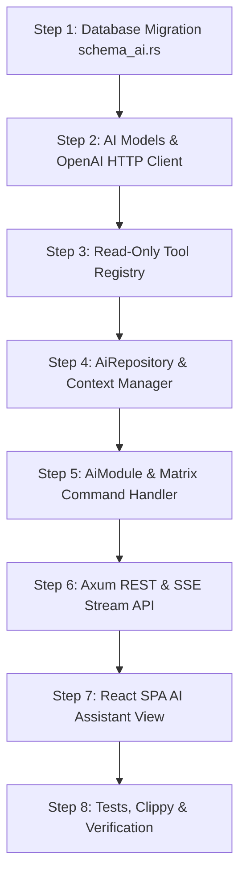

# AI Assistant Subsystem: Architecture & Implementation Specification 🧠

**Document Status**: Approved / Audit-Ready  
**Branch**: `ai-assistant-integration`  
**Target Version**: `0.2.0`  
**Authors**: Senior System Architect & Development Team  

---

## 1. Executive Summary & Problem Statement

`matrix-bot` provides rich productivity, finance, portfolio, reminder, and inbound webhook capabilities reachable via Matrix chat commands and a React Web SPA. However, all interactions currently rely on exact syntax commands (e.g. `!expense add 15 USD lunch -c Food`, `!todo due 1 2h remind 30m`).

The **AI Assistant Subsystem** introduces conversational intelligence to `matrix-bot`. It allows users to query information naturally, chat conversationally in 1:1 DMs, ask questions in group rooms, and empower the AI to inspect caller-scoped tasks, reminders, bills, and financial ledgers through secure read-only function calling.

---

## 2. Goals and Non-Goals

### Goals
1. **Universal LLM Compatibility**: Support local models (Ollama, vLLM, LocalAI) and cloud providers (OpenAI, Groq, DeepSeek, OpenRouter) via the standard OpenAI Chat Completions protocol (`/v1/chat/completions`).
2. **Context-Aware Multi-Turn Memory**: Retain recent conversational context across turns per user/room with automatic 30-minute inactivity pruning and manual `!ai reset`.
3. **Safe Read-Only Agentic Tool Calling**: Provide the LLM with read-only function schemas to query Tasks, Reminders, Bills, Finance summaries, Portfolio totals, and User Settings, strictly scoped to the authenticated caller's `owner_id`.
4. **Dual Matrix & Web Interface**:
   - **Matrix Chat**: Seamless DM chat, group room mentions/prefixes, live typing indicator during generation, and formatted Markdown output.
   - **Web UI**: Dedicated interactive AI Chat tab in the React SPA with real-time SSE token streaming, Markdown code highlighting, and tool call indicators.
5. **Configurability & Privacy**: System-wide default model/endpoint with optional per-account user overrides in Web Settings.

### Non-Goals
1. **No Autonomous Data Mutation**: The AI will NOT mutate, delete, or create records (e.g. will not execute financial transactions or delete tasks) in this phase.
2. **No Proprietary Vendor Lock-in**: No vendor-specific SDK dependencies (e.g. direct Google Gemini or Anthropic SDKs); all integrations use the OpenAI-compatible HTTP protocol.
3. **No Voice/Audio Streaming**: Text-based streaming and completions only.

---

## 3. System Architecture & Context

```
                               ┌──────────────────────────────────────────────┐
                               │             React Web Client                 │
                               │  - Markdown Chat View & Code Highlighting    │
                               │  - Real-Time SSE Token Stream                │
                               │  - Model / API Key Configuration Panel       │
                               └──────────────────────┬───────────────────────┘
                                                      │ /api/v1/ai/*
                                                      ▼
┌─────────────────────────┐    ┌──────────────────────────────────────────────┐    ┌───────────────────────────┐
│    Matrix Homeserver    │───▶│            matrix-bot Daemon (Rust)          │───▶│   OpenAI-Compatible LLM   │
│ - 1:1 Direct Messages   │    │ ┌──────────────────────────────────────────┐ │    │ - Ollama / LocalAI (LAN)  │
│ - Shared Room Mentions  │◀───│ │ AiModule (BotModule Plugin)              │ │◀───│ - OpenAI / Groq /         │
│ - Typing Indicators     │    │ │ - Context Manager (Sliding 30m Window)   │ │    │   DeepSeek / OpenRouter   │
└─────────────────────────┘    │ │ - Read-Only Tool Dispatcher              │ │    └───────────────────────────┘
                               │ │ - System / User Config Resolver          │ │
                               │ └──────────────────────────────────────────┘ │
                               └──────────────────────┬───────────────────────┘
                                                      │ SQLx Runtime Queries
                                                      ▼
                               ┌──────────────────────────────────────────────┐
                               │              SQLite Database                 │
                               │  - ai_conversations                          │
                               │  - ai_messages                               │
                               │  - ai_user_configs                           │
                               └──────────────────────────────────────────────┘
```

---

## 4. Component Responsibilities

| Component | File Path | Responsibilities |
|---|---|---|
| **`AiModule`** | `backend/src/modules/ai/mod.rs` | Implements `BotModule` trait, registers commands (`!ai`), and routes direct messages. |
| **`LlmClient`** | `backend/src/services/llm/client.rs` | Asynchronous HTTP client for any OpenAI-compatible `/chat/completions` API, streaming (SSE) and non-streaming. The AI module reaches it through `ResolvedAiConfig::endpoint()` (`backend/src/modules/ai/resolved_config.rs`). |
| **`ToolRegistry`** | `backend/src/modules/ai/tools/` | JSON schema definitions and domain-grouped execution dispatchers (`todo.rs`, `finance.rs`, `reminder.rs`, `portfolio.rs`, etc.). |
| **`AiRepository`** | `backend/src/modules/ai/repository.rs` | Persistence for conversation sessions, message turns, and per-user configuration overrides. |
| **`AiHandler`** | `backend/src/modules/ai/handler.rs` | Matrix mention/command parsing, context assembly, typing indicator lifecycle, and response formatting. |
| **`AiApi`** | `backend/src/api/ai.rs` | REST & SSE endpoints for Web UI chat streaming, conversation management, and user model configuration. |
| **`AiFrontend`** | `frontend/src/modules/ai/index.tsx` | React chat UI, SSE consumer, auto-scrolling, tool-call badges, and model switchers. |

---

## 5. Database Schema Migration (`backend/src/db/schema_ai.rs`)

```sql
-- Per-user AI settings (API key, custom endpoint, preferred model)
CREATE TABLE IF NOT EXISTS ai_user_configs (
    owner_id TEXT PRIMARY KEY REFERENCES accounts(id) ON DELETE CASCADE,
    api_base_url TEXT,
    api_key TEXT,
    model_name TEXT,
    system_prompt TEXT,
    temperature REAL DEFAULT 0.7,
    max_tokens INTEGER DEFAULT 2048,
    updated_at TIMESTAMP NOT NULL DEFAULT CURRENT_TIMESTAMP
);

-- Multi-turn conversation sessions
CREATE TABLE IF NOT EXISTS ai_conversations (
    id TEXT PRIMARY KEY,
    owner_id TEXT NOT NULL REFERENCES accounts(id) ON DELETE CASCADE,
    room_id TEXT NOT NULL,
    created_at TIMESTAMP NOT NULL DEFAULT CURRENT_TIMESTAMP,
    updated_at TIMESTAMP NOT NULL DEFAULT CURRENT_TIMESTAMP
);

CREATE INDEX IF NOT EXISTS idx_ai_conversations_owner_room 
ON ai_conversations(owner_id, room_id, updated_at);

-- Context history messages
CREATE TABLE IF NOT EXISTS ai_messages (
    id TEXT PRIMARY KEY,
    conversation_id TEXT NOT NULL REFERENCES ai_conversations(id) ON DELETE CASCADE,
    role TEXT NOT NULL CHECK (role IN ('system', 'user', 'assistant', 'tool')),
    content TEXT NOT NULL,
    tool_call_id TEXT,
    tool_name TEXT,
    created_at TIMESTAMP NOT NULL DEFAULT CURRENT_TIMESTAMP
);

CREATE INDEX IF NOT EXISTS idx_ai_messages_conv_created 
ON ai_messages(conversation_id, created_at);
```

---

## 6. Functional Specification & Control Flow

### 6.1. Matrix Chat Flow

```
User in Matrix                AiHandler / AiModule                 ToolRegistry / LLM
      │                                │                                    │
      │── 1. Send "!ai ..." or DM ────▶│                                    │
      │                                │── 2. Resolve account & session ───▶│
      │                                │── 3. Start Matrix typing indicator │
      │                                │── 4. Build prompt + Tool schemas ─▶│
      │                                │                                    │── 5. LLM generates completion
      │                                │◀── 6. Tool Call Requested ─────────│      (or tool_call)
      │                                │                                    │
      │                                │── 7. Execute Read-Only Tool ───────│ (Scoped to owner_id)
      │                                │── 8. Send Tool Result back to LLM ─▶│
      │                                │◀── 9. Final Answer Text ───────────│
      │                                │                                    │
      │◀── 10. Matrix HTML Reply ──────│ (Stops typing indicator)           │
```

1. **Trigger Resolution**:
   - **1:1 DM**: Any message that does NOT match an explicit registered prefix command (e.g. `!todo`, `!expense`, `!link`) is routed to the AI assistant.
   - **Shared/Group Rooms**: Triggers on `!ai <prompt>` or when the bot is directly mentioned (`@bot_username <prompt>`).
2. **Context Resolution**:
   - Looks up the active conversation in `ai_conversations` for `(owner_id, room_id)`.
   - If `updated_at < now - 30 minutes`, the old conversation is archived/reset and a new conversation is started.
   - Fetches the last $N$ turns (default 10 messages) from `ai_messages`.
3. **Typing Indicator**:
   - Emits `matrix_sdk::room::Room::typing_notice(true)` in the target room. A periodic refresh loop keeps typing active during longer tool calls.
4. **Tool Call Execution Loop**:
   - If the LLM requests a tool call (e.g. `get_my_tasks`), `ToolRegistry` executes the query scoped strictly to `owner_id`.
   - The tool response is appended to the message array with role `tool`, and sent back to the LLM for final synthesis.
5. **Matrix Message Delivery**:
   - The final Markdown response is parsed into Matrix HTML using `utils::html::html_escape` and sent to the room.
   - Saves `user` and `assistant` messages to `ai_messages`.

---

### 6.2. Web UI Real-Time Streaming Flow (`/api/v1/ai/chat/stream`)

1. User sends prompt from the Web SPA.
2. Axum endpoint verifies session cookie and loads user's `ai_user_configs`.
3. Streams response back to the browser using `text/event-stream` chunks:
   ```text
   event: chunk
   data: {"delta": "Hello! "}

   event: tool_start
   data: {"tool": "get_my_tasks"}

   event: chunk
   data: {"delta": "You have 3 tasks due today."}

   event: done
   data: {"conversation_id": "conv_123"}
   ```

---

## 7. Read-Only Toolset Specification

The LLM is provided with the following JSON schema tool definitions:

### 1. `get_my_tasks`
* **Description**: Returns active and completed tasks for the current user.
* **Parameters**:
  * `status` (string, optional): `"active"`, `"completed"`, or `"all"`.
  * `priority` (string, optional): `"low"`, `"medium"`, `"high"`.
* **Execution**: Calls `TodoRepository::find_all_for_owner(pool, owner_id)`.

### 2. `get_my_reminders`
* **Description**: Returns upcoming reminders scheduled for the current user.
* **Parameters**:
  * `status` (string, optional): `"pending"`, `"triggered"`, or `"all"`.
* **Execution**: Calls `ReminderRepository::find_all_for_owner(pool, owner_id)`.

### 3. `get_my_recurring_bills`
* **Description**: Returns recurring bills, subscriptions, and next due dates.
* **Parameters**: None.
* **Execution**: Calls `RecurringBillRepository::list_by_owner(pool, owner_id)`.

### 4. `get_my_financial_summary`
* **Description**: Returns income and expense totals grouped by category and currency.
* **Parameters**:
  * `currency` (string, optional): e.g. `"USD"`, `"EUR"`.
* **Execution**: Calls `FinanceRepository::summary(pool, owner_id)`.

### 5. `get_my_portfolio_summary`
* **Description**: Returns asset holdings, current valuations, cash balance, and unrealized P&L.
* **Parameters**: None.
* **Execution**: Calls `PortfolioRepository::summary(pool, owner_id)`.

### 6. `get_my_settings`
* **Description**: Returns the user's configured timezone (e.g. `America/New_York`) and default currency.
* **Parameters**: None.
* **Execution**: Calls `SettingsRepository::get_or_default(pool, owner_id)`.

---

## 8. Action & Mutation Toolset Specification ✍️

The AI assistant also has access to write tools allowing users to command natural language mutations:

### 7. `add_todo`
* **Description**: Adds a task / to-do with optional priority, relative/absolute due dates, and lead-time reminders.
* **Parameters**: `text` (required), `priority` (optional), `due_in_minutes` (optional), `due_at` (optional), `remind_before_minutes` (optional).
* **Execution**: Calls `TodoRepository::add(...)` and broadcasts `SystemEvent::TodoCreated`.

### 8. `complete_todo`
* **Description**: Marks a task as completed by ID or substring search.
* **Parameters**: `id` (optional), `text_search` (optional).
* **Execution**: Calls `TodoRepository::set_completed(...)` and broadcasts `SystemEvent::TodoUpdated`.

### 9. `record_finance_entry`
* **Description**: Records an expense or income transaction in the ledger.
* **Parameters**: `amount` (required), `direction` (required: "expense" or "income"), `note` (required), `currency` (optional), `category` (optional).
* **Execution**: Minor unit conversion, auto category creation, calls `FinanceRepository::create_transaction(...)`, and broadcasts `SystemEvent::TransactionCreated`.

### 10. `set_reminder`
* **Description**: Schedules a reminder with relative minutes or timestamp, and optional recurrence pattern.
* **Parameters**: `message` (required), `in_minutes` (optional), `trigger_at` (optional), `recurrence` (optional).
* **Execution**: Calls `ReminderRepository::create(...)` and broadcasts `SystemEvent::ReminderCreated`.

### 11. `deposit_portfolio_cash`
* **Description**: Deposits uninvested cash into the user's portfolio.
* **Parameters**: `amount` (required), `currency` (optional).
* **Execution**: Calls `PortfolioRepository::deposit_cash(...)` and broadcasts `SystemEvent::PortfolioCashUpdated`.

### 12. `buy_portfolio_holding`
* **Description**: Records purchase of an investment position, validating sufficient cash balance.
* **Parameters**: `symbol` (required), `quantity` (required), `price` (required), `currency` (optional).
* **Execution**: Calls `PortfolioRepository::buy(...)` and broadcasts `SystemEvent::PortfolioHoldingUpdated` & `SystemEvent::PortfolioCashUpdated`.

---

## 8. REST & Web API Specification

| Method | Path | Auth | Description |
|---|---|---|---|
| `POST` | `/api/v1/ai/chat` | Session Cookie | Non-streaming chat completion with tool execution. |
| `GET` | `/api/v1/ai/chat/stream` | Session Cookie | SSE real-time token stream. |
| `GET` | `/api/v1/ai/conversations` | Session Cookie | List recent conversations for the account. |
| `GET` | `/api/v1/ai/conversations/:id/messages` | Session Cookie | Retrieve turn history for a conversation. |
| `DELETE` | `/api/v1/ai/conversations/:id` | Session Cookie | Delete a conversation and reset session. |
| `GET` | `/api/v1/account/ai-config` | Session Cookie | Retrieve caller's AI settings & default model. |
| `PUT` | `/api/v1/account/ai-config` | Session Cookie | Update caller's AI settings (custom endpoint, key, model). |

---

## 9. Security, Safety & Privacy Considerations

1. **Strict Multi-Tenant Isolation**:
   * All tool calls resolve the sender's account ID via `AccountRepository::find_by_matrix_user_id`.
   * Unlinked Matrix senders in shared rooms cannot access private data; tools return an empty state or message indicating account linking is required (`!link`).
2. **Prompt Injection Mitigation**:
   * Tool outputs are sanitized and formatted strictly as JSON before feeding back to the model.
   * System prompt enforces clear boundaries: *"You are an assistant. Only use tools when requested. Never execute actions outside the read-only tools provided."*
3. **API Key Encryption & Redaction**:
   * User-supplied API keys are never logged in debug outputs or Matrix error messages.
   * Redacted in `/account/ai-config` GET responses (e.g. `sk-...4a2b`).
4. **Rate Limiting & Cost Guardrails**:
   * Maximum 30 AI requests per minute per user.
   * Maximum 4,096 completion tokens per request to prevent runaway loops.
   * Tool recursion depth limited to max 3 iterations.

---

## 10. Chat Commands Reference

| Command | Arguments | Description | Example |
|---|---|---|---|
| `!ai` / `!ask` | `<prompt>` | Ask a question or chat with the AI assistant | `!ai what tasks do I have due today?` |
| `!ai reset` | None | Clear conversational memory in this room | `!ai reset` |
| `!ai model` | `[model_name]` | View or switch the active model | `!ai model llama3.2` |
| `!ai config` | None | View current AI backend endpoint and settings | `!ai config` |

---

## 11. Testing & Verification Strategy

### 11.1. Backend Automated Tests (`cargo test`)
* **Unit Tests**:
  * `client_tests`: Mock OpenAI-compatible HTTP server verifying request headers, SSE stream parsing, and error status handling.
  * `tools_tests`: Verify tool JSON serialization, argument parsing, and scoped SQL execution against in-memory SQLite.
  * `repository_tests`: Test conversation lifecycle, message insertion, sliding window retrieval, and cascade deletion.
  * `handler_tests`: Test `!ai` command dispatch, DM auto-routing, and `!ai reset`.
* **API Tests**:
  * Test `/api/v1/ai/chat`, `/api/v1/account/ai-config`, and conversation CRUD.

### 11.2. Frontend E2E Tests (Playwright)
* **`e2e/ai-chat.spec.ts`**:
  * Navigate to AI Assistant tab.
  * Send prompt and verify real-time streaming response rendering.
  * Verify tool call badge appearance.
  * Reset conversation and verify message list clears.
  * Configure custom model in settings and verify persistence.

---

## 12. Implementation Phasing & Step-by-Step Plan



1. **Step 1: Database Migration**: Create `backend/src/db/schema_ai.rs` with `ai_user_configs`, `ai_conversations`, `ai_messages`.
2. **Step 2: Core Models & HTTP Client**: Implement `models.rs` and `client.rs` using `reqwest` for `/v1/chat/completions`.
3. **Step 3: Read-Only Tools**: Implement `tools.rs` mapping tool schemas to database repositories.
4. **Step 4: Repository**: Implement `repository.rs` for multi-turn session management.
5. **Step 5: Bot Module & Matrix Handler**: Implement `handler.rs` and `mod.rs` with typing indicators and Markdown replies.
6. **Step 6: REST API**: Implement `backend/src/api/ai.rs` with SSE streaming and OpenAPI documentation.
7. **Step 7: Frontend UI**: Build `frontend/src/modules/ai/` with real-time SSE stream reader, tool call badges, and settings.
8. **Step 8: E2E Tests & Verification**: Write Playwright specs, run `cargo clippy`, and verify 100% test pass rate.
