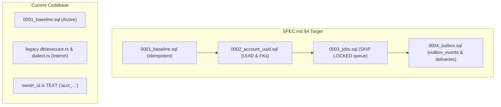
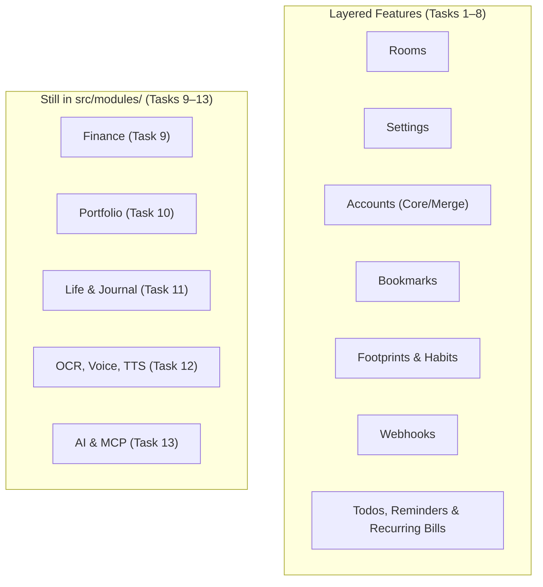
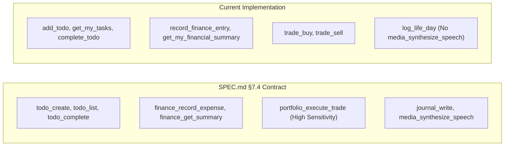

# Matrix Bot — Specification vs. Codebase Gap Analysis

> **Specification Source:** [`SPEC.md`](file:///d:/01_Data/code/matrix-hello-bot/SPEC.md) (v2.4.0)  
> **Repository Branch:** `refactor/postgres-layered`  
> **Commit Inspected:** `f1e9197` (Task 8 of Feature Layering)  
> **Reference Plan & Status:** [`docs/HANDOFF.md`](file:///d:/01_Data/code/matrix-hello-bot/docs/HANDOFF.md) & [`docs/superpowers/specs/2026-09-24-postgres-foundation-design.md`](file:///d:/01_Data/code/matrix-hello-bot/docs/superpowers/specs/2026-09-24-postgres-foundation-design.md)

---

## Executive Summary

[`SPEC.md`](file:///d:/01_Data/code/matrix-hello-bot/SPEC.md) defines a six-phase evolution from a Matrix-only bot to an **Omnichannel Personal Life Workspace**. In the project's execution plan, this roadmap is divided into **four sequential sub-projects**:

1. **Sub-project 1 (Phases 1–3) — PostgreSQL Foundation & Layer-First Refactor:** Mid-way through implementation. Tasks 1–8 of Step 6 are complete; Tasks 9–14 and Steps 7–10 remain.
2. **Sub-project 2 (Phase 4) — Omnichannel Extensions (Discord, Telegram, `ChannelAdapter`):** Not yet designed or implemented.
3. **Sub-project 3 (Phase 5) — Scheduled Autonomous Agent Runtime & Storage Decoupling:** Not yet designed or implemented.
4. **Sub-project 4 (Phase 6) — Web Console & Multi-Interface Polish:** Not yet designed or implemented.

The gaps identified between [`SPEC.md`](file:///d:/01_Data/code/matrix-hello-bot/SPEC.md) and the current codebase fall into three distinct classes:
- **Roadmap Gaps:** Features explicitly marked as planned ([TODO Feature]) in the roadmap (e.g. Discord, Telegram, Agent Runtime, Object Storage).
- **In-Flight Refactoring Gaps:** Items in Sub-project 1 where implementation is actively progressing but not yet completed (e.g. remaining feature migrations, `UUID` account IDs, durable `jobs` table, and `outbox_events`).
- **Design & Contract Divergences:** Specific places where current implementations differ from naming, schema conventions, or traits described in [`SPEC.md`](file:///d:/01_Data/code/matrix-hello-bot/SPEC.md) (e.g. tool naming schemes and `ToolDefinition` schemas).

---

## Sub-Project Status Matrix

| Sub-Project | Roadmap Phase | Primary Capabilities in Spec | Current Codebase State | Status |
|---|---|---|---|---|
| **Sub-project 1** | **Phases 1–3** | PostgreSQL exclusivity, layer-first architecture, compile-checked SQL, account `UUID`, durable `jobs` queue, transactional `outbox` | sqlx 0.9 & matrix-sdk 0.18 upgraded; baseline migration applied; 8 of 14 features layered; dual-dialect macros and in-memory background loops still present | 🟡 **In Progress** (~60% of Foundation) |
| **Sub-project 2** | **Phase 4** | `ChannelAdapter`, `ChannelRegistry`, Discord (`serenity`), Telegram (`teloxide`), `platform_identities` | Only Matrix adapter exists; no Discord or Telegram dependencies in [`Cargo.toml`](file:///d:/01_Data/code/matrix-hello-bot/backend/Cargo.toml) | 🔴 **Planned / Not Started** |
| **Sub-project 3** | **Phase 5** | `ScheduledAgentTask`, `agent_runs`, `agent_steps`, `StorageService` (S3/Local) | No agent scheduler; no object storage abstractions; media stored as Matrix IDs or in-memory | 🔴 **Planned / Not Started** |
| **Sub-project 4** | **Phase 6** | SSE-driven live UI sync, multi-platform identity UI settings | WebAuthn passkey login and REST API active; UI settings for linked identities and SSE outbox sync not yet wired | 🔴 **Planned / Not Started** |

---

## Detailed Gap Analysis by Subsystem

### 1. Database & Migrations ([`SPEC.md §2`](file:///d:/01_Data/code/matrix-hello-bot/SPEC.md#L228), [`§4`](file:///d:/01_Data/code/matrix-hello-bot/SPEC.md#L338))

| Specification Requirement | Codebase Implementation | Gap Classification | Details / Location |
|---|---|---|---|
| **PostgreSQL Exclusivity** | PostgreSQL only for app data; matrix-sdk manages SQLite crypto store in `data/`. | ✅ Aligned | Enforced in [`backend/Cargo.toml`](file:///d:/01_Data/code/matrix-hello-bot/backend/Cargo.toml) (no sqlite feature in sqlx). |
| **Removal of Dual-Dialect Macros** | `db_fetch_*!`, `tx_*!`, and `dialect.rs` still exist in [`backend/src/db/`](file:///d:/01_Data/code/matrix-hello-bot/backend/src/db/). | 🟡 In-Flight Gap | Scheduled for deletion in Task 14 after all features are moved to `query!`. |
| **Migrations Pipeline** | Only [`backend/migrations/0001_baseline.sql`](file:///d:/01_Data/code/matrix-hello-bot/backend/migrations/0001_baseline.sql) exists. | 🟡 In-Flight Gap | Migrations `0002_account_uuid.sql`, `0003_jobs.sql`, and `0004_outbox.sql` are pending Steps 7–9. |
| **Account & Owner Identifiers** | `SPEC.md §4.1`: `accounts.id` and all `owner_id` columns must be native `UUID`; in Rust: `AccountId(Uuid)`. | 🟡 In-Flight Gap | Currently `accounts.id` and `owner_id` are `TEXT` (`acct_<uuid>`). [`AccountId`](file:///d:/01_Data/code/matrix-hello-bot/backend/src/domain/accounts/mod.rs#L21) is a newtype over `String`. |
| **Table Inventory** | Tables `jobs`, `outbox_events`, `outbox_deliveries`, `platform_identities`, `scheduled_agent_tasks`, `agent_runs`, `agent_steps` specified. | 🟡 In-Flight / Roadmap Gap | `webhook_outbox` is still active; new tables have not yet been created in migrations. |

---

### 2. Codebase Layering & Architecture ([`SPEC.md §3`](file:///d:/01_Data/code/matrix-hello-bot/SPEC.md#L269), [`§13`](file:///d:/01_Data/code/matrix-hello-bot/SPEC.md#L1271))

[`SPEC.md §13`](file:///d:/01_Data/code/matrix-hello-bot/SPEC.md#L1271) specifies a strict Six-Layer model (`domain/`, `application/`, `infrastructure/`, `interface/`, `llm/`, `jobs/`, `events/`).

| Target Directory / Layer | Current Codebase Status | Gap Details |
|---|---|---|
| [`backend/src/domain/`](file:///d:/01_Data/code/matrix-hello-bot/backend/src/domain/) | Contains 8 features: `accounts`, `bookmarks`, `footprints`, `habits`, `recurring_bills`, `reminders`, `rooms`, `settings`, `todos`, `webhooks`. | Missing domain packages for `finance`, `portfolio`, `life`, `journal`. Pure invariant enforcement verified by [`tests/architecture.rs`](file:///d:/01_Data/code/matrix-hello-bot/backend/tests/architecture.rs). |
| [`backend/src/application/`](file:///d:/01_Data/code/matrix-hello-bot/backend/src/application/) | Contains use-case services: `AccountService`, `BookmarkService`, `FootprintService`, `HabitService`, `RecurringBillsService`, `ReminderService`, `RoomService`, `SettingsService`, `TodoService`, `WebhookService`. | Missing services for `finance`, `portfolio`, `life`, `journal`, and `ai`. |
| [`backend/src/infrastructure/postgres/`](file:///d:/01_Data/code/matrix-hello-bot/backend/src/infrastructure/postgres/) | Repositories for layered features using compile-checked `sqlx::query!`. | Missing repositories for `finance`, `portfolio`, and read models. |
| `backend/src/llm/` | **Does not exist.** | All LLM code is currently located in legacy [`backend/src/modules/ai/`](file:///d:/01_Data/code/matrix-hello-bot/backend/src/modules/ai/). |
| `backend/src/jobs/` | **Does not exist.** | Background jobs run as ad-hoc async loops (`due_reminder`, `scheduler.rs`). |
| `backend/src/events/` | [`backend/src/events.rs`](file:///d:/01_Data/code/matrix-hello-bot/backend/src/events.rs) exists as a single file. | Operates via in-memory `tokio::sync::broadcast`, not transactional PostgreSQL outbox tables. |
| [`backend/src/interface/chat/`](file:///d:/01_Data/code/matrix-hello-bot/backend/src/interface/chat/) | Chat handlers created for layered features. | 5 files still remain in `INTERFACE_SQL_ALLOW_LIST` in [`tests/architecture.rs`](file:///d:/01_Data/code/matrix-hello-bot/backend/tests/architecture.rs#L129). |
| `backend/src/interface/mcp/` | **Does not exist.** | MCP server code remains in [`backend/src/modules/mcp/`](file:///d:/01_Data/code/matrix-hello-bot/backend/src/modules/mcp/). |

---

### 3. Background Processing & Durable Job Queue ([`SPEC.md §5`](file:///d:/01_Data/code/matrix-hello-bot/SPEC.md#L377))

| Specification Requirement | Codebase Implementation | Gap Classification |
|---|---|---|
| **Native PostgreSQL Job Queue** (`FOR UPDATE SKIP LOCKED`) | No `jobs` table or worker engine exists. | 🟡 In-Flight Gap (Step 8) |
| **Worker Heartbeat & Reaper** (`heartbeat_at < NOW() - 2m`) | No heartbeat mechanism or stuck-worker reaper. | 🟡 In-Flight Gap (Step 8) |
| **Scheduler Advisory Locks** (`pg_try_advisory_lock`) | Schedulers run without distributed leader locks. | 🟡 In-Flight Gap (Step 8) |
| **Durable Handlers** (Reminders, Audio Synthesis, OCR) | Background routines run as unbounded `tokio::spawn` loops in [`interface/chat/reminders/scheduler.rs`](file:///d:/01_Data/code/matrix-hello-bot/backend/src/interface/chat/reminders/scheduler.rs) and `modules/*/scheduler.rs`. | 🟡 In-Flight Gap (Step 8) |

---

### 4. Transactional Outbox & Omnichannel Notifications ([`SPEC.md §6`](file:///d:/01_Data/code/matrix-hello-bot/SPEC.md#L453))

| Specification Requirement | Codebase Implementation | Gap Classification |
|---|---|---|
| **Outbox Tables** (`outbox_events`, `outbox_deliveries`) | No outbox tables in PostgreSQL; only legacy [`webhook_outbox`](file:///d:/01_Data/code/matrix-hello-bot/backend/migrations/0001_baseline.sql#L469). | 🟡 In-Flight Gap (Step 9) |
| **PostgreSQL `LISTEN` / `NOTIFY` Dispatcher** | System events are broadcast in-process using Tokio `broadcast::Sender<SystemEvent>`. | 🟡 In-Flight Gap (Step 9) |
| **SSE Delivery via Outbox** | Axum SSE endpoint directly attaches to `EventBroadcaster` in memory. | 🟡 In-Flight Gap (Step 9) |
| **Independent Destination Retries** (`X-Delivery-Id`) | Only webhooks have independent retries in `webhook_outbox`; chat notifications do not use durable delivery rows. | 🟡 In-Flight Gap (Step 9) |

---

### 5. Unified Tool Registry & AI Calling ([`SPEC.md §7`](file:///d:/01_Data/code/matrix-hello-bot/SPEC.md#L525))

| Specification Requirement | Codebase Implementation | Gap Classification |
|---|---|---|
| **Standardized Tool Names** (`<ns>_<action>`) | Tools use legacy names: [`add_todo`](file:///d:/01_Data/code/matrix-hello-bot/backend/src/modules/ai/tools/todo.rs#L253), [`get_my_tasks`](file:///d:/01_Data/code/matrix-hello-bot/backend/src/modules/ai/tools/todo.rs#L238), [`record_finance_entry`](file:///d:/01_Data/code/matrix-hello-bot/backend/src/modules/ai/tools/finance.rs#L328), [`log_life_day`](file:///d:/01_Data/code/matrix-hello-bot/backend/src/modules/ai/tools/life.rs#L43). | 🟠 Divergence / Task 13 Scope |
| **Tool Definition Schema** (`ToolParameterSchema`, `is_sensitive`, `allowed_interfaces`) | [`ToolDefinition`](file:///d:/01_Data/code/matrix-hello-bot/backend/src/infrastructure/inference/llm/types.rs#L39) is standard OpenAI `{ type, function }`; no `is_sensitive` or `allowed_interfaces` fields. | 🟠 Divergence / Roadmap Gap |
| **Extensible `ToolHandler` Trait** | Tool execution uses a centralized `match` dispatcher in [`ToolRegistry::execute_tool`](file:///d:/01_Data/code/matrix-hello-bot/backend/src/modules/ai/tools/mod.rs#L25) and [`executor.rs`](file:///d:/01_Data/code/matrix-hello-bot/backend/src/modules/ai/tools/executor.rs). | 🟠 Divergence / Task 13 Scope |
| **Bounded Tool Calling Loop** (`MAX_TOOL_ROUNDS`) | A bounded loop exists in [`handler.rs`](file:///d:/01_Data/code/matrix-hello-bot/backend/src/modules/ai/handler.rs#L318), but `max_iterations = 5` is locally hardcoded rather than an exported constant. | 🟡 In-Flight Gap (Task 13) |
| **Missing Tools** (`journal_write`, `media_synthesize_speech`) | `journal_write` is covered by `log_life_day`; `media_synthesize_speech` does not exist as an AI tool. | 🟠 Divergence |

---

### 6. Scheduled Autonomous Agent Runtime ([`SPEC.md §8`](file:///d:/01_Data/code/matrix-hello-bot/SPEC.md#L685))

| Specification Requirement | Codebase Implementation | Gap Classification |
|---|---|---|
| **`ScheduledAgentTask` Trait & Registry** | Completely missing. | 🔴 Planned (Sub-project 3 / Phase 5) |
| **Agent Persistence Schema** (`scheduled_agent_tasks`, `agent_runs`, `agent_steps`) | None of these tables exist in migrations or codebase. | 🔴 Planned (Sub-project 3 / Phase 5) |
| **ReAct Loop Worker Engine** | No autonomous step-by-step reasoning and acting background engine exists. | 🔴 Planned (Sub-project 3 / Phase 5) |
| **Built-in Task Plugins** (`WeeklyBookmarkDigestTask`, etc.) | None implemented. | 🔴 Planned (Sub-project 3 / Phase 5) |

---

### 7. Omnichannel Interface & Adapters ([`SPEC.md §9`](file:///d:/01_Data/code/matrix-hello-bot/SPEC.md#L873))

| Specification Requirement | Codebase Implementation | Gap Classification |
|---|---|---|
| **`ChannelAdapter` Trait & `ChannelRegistry`** | Neither trait nor registry exists in [`interface/channels/`](file:///d:/01_Data/code/matrix-hello-bot/backend/src/interface/channels/). | 🔴 Planned (Sub-project 2 / Phase 4) |
| **Normalized Message Envelopes** (`IncomingMessage`, `OutgoingMessage`) | Messages use platform-specific types ([`MatrixCommand`](file:///d:/01_Data/code/matrix-hello-bot/backend/src/interface/chat/mod.rs), [`CommandContext`](file:///d:/01_Data/code/matrix-hello-bot/backend/src/interface/channels/matrix/command_flow.rs)). | 🔴 Planned (Sub-project 2 / Phase 4) |
| **Discord Adapter (`serenity`)** | No `serenity` dependency; no Discord gateway/slash commands. | 🔴 Planned (Sub-project 2 / Phase 4) |
| **Telegram Adapter (`teloxide`)** | No `teloxide` dependency; no Telegram webhook/polling adapter. | 🔴 Planned (Sub-project 2 / Phase 4) |
| **Unified `platform_identities` Table** | Only `matrix_links` exists for MXID-to-account mapping. | 🔴 Planned (Sub-project 2 / Phase 4) |
| **Cross-Platform Format Normalization** | Formatting is handled via Matrix HTML (`text_html`). | 🔴 Planned (Sub-project 2 / Phase 4) |

---

### 8. External Media & Object Storage ([`SPEC.md §10`](file:///d:/01_Data/code/matrix-hello-bot/SPEC.md#L1159), [`§11`](file:///d:/01_Data/code/matrix-hello-bot/SPEC.md#L1225))

| Specification Requirement | Codebase Implementation | Gap Classification |
|---|---|---|
| **Provider Traits** (`SttProvider`, `TtsProvider`, `OcrProvider`) | HTTP client functions exist in [`infrastructure/inference/`](file:///d:/01_Data/code/matrix-hello-bot/backend/src/infrastructure/inference/), but without dynamic trait abstractions. | 🔴 Planned (Sub-project 3 / Phase 5) |
| **`StorageService` Trait** (S3/R2/Local) | No storage abstraction exists. Binary files are handled in-memory or through Matrix media store. | 🔴 Planned (Sub-project 3 / Phase 5) |
| **Omnichannel Receipt Pipeline** (`media.process_receipt` job) | Receipts are processed directly in Matrix event flow without durable job queueing or S3 keys. | 🔴 Planned (Sub-project 3 / Phase 5) |

---

### 9. Security, Authentication & Multi-Tenancy ([`SPEC.md §12`](file:///d:/01_Data/code/matrix-hello-bot/SPEC.md#L1248))

| Specification Requirement | Codebase Implementation | Status |
|---|---|---|
| **WebAuthn / Passkeys as Exclusive Web Auth** | Implemented using `webauthn-rs` in [`interface/http/auth/`](file:///d:/01_Data/code/matrix-hello-bot/backend/src/interface/http/auth/). Passwords banned. | ✅ Aligned |
| **Session Security (SHA-256 tokens)** | Session cookies stored only as SHA-256 hashes in `sessions` table. | ✅ Aligned |
| **Step-Up Verification (`VerifiedUser`)** | Enforced on sensitive endpoints within a 5-minute window (`STEP_UP_WINDOW_MINUTES = 5`). | ✅ Aligned |
| **DM Isolation for Sensitive Commands** | Financial, portfolio, and settings commands refuse execution in public rooms. | ✅ Aligned |
| **Single-Use `/link` Ceremony** | Handled in DM with single-use challenge code and passkey confirmation. | ✅ Aligned (Matrix-only) |

---

## Summary of Actionable Items

To bring the codebase into full alignment with [`SPEC.md`](file:///d:/01_Data/code/matrix-hello-bot/SPEC.md), work must continue according to the sub-project roadmap:

1. **Immediate Focus: Complete Sub-project 1 (Phases 1–3)**
   - Complete remaining feature layering tasks: Task 9 (`finance`), Task 10 (`portfolio`), Task 11 (`life`/`journal`/`briefing`), Task 12 (`ocr`/`voice`/`tts`/`core`), Task 13 (`ai`/`mcp`).
   - Standardize AI tool function names to `<namespace>_<action>` (resolving the naming gap) and define `MAX_TOOL_ROUNDS`.
   - Task 14: Delete `db/executor.rs`, `db/dialect.rs`, and `INTERFACE_SQL_ALLOW_LIST`.
   - Step 7: Migration `0002_account_uuid.sql` (convert `accounts.id` and all `owner_id`s to native `UUID`).
   - Step 8: Migration `0003_jobs.sql` and durable job queue engine (`src/jobs/`).
   - Step 9: Migration `0004_outbox.sql` and outbox dispatcher (`src/events/`).
2. **Sub-project 2 (Phase 4): Omnichannel Interface**
   - Design and implement `ChannelAdapter`, `ChannelRegistry`, `platform_identities`, and Discord/Telegram adapters.
3. **Sub-project 3 (Phase 5): Scheduled Agent Runtime & Storage**
   - Design and implement `ScheduledAgentTask`, `StorageService` (S3/Local), and the background ReAct loop.
4. **Sub-project 4 (Phase 6): Web & API Polish**
   - Connect web SSE to PostgreSQL `LISTEN` and expose identity management UI.
