# Master Plan: Eliminating Gaps Between Codebase and SPEC.md

> **Target:** Full alignment between the codebase and [`SPEC.md`](file:///d:/01_Data/code/matrix-hello-bot/SPEC.md) (v2.4.0).  
> **Approach:** Phased, test-driven refactor respecting settled architectural rulings in [`AGENTS.md`](file:///d:/01_Data/code/matrix-hello-bot/AGENTS.md) and [`docs/HANDOFF.md`](file:///d:/01_Data/code/matrix-hello-bot/docs/HANDOFF.md).  
> **Branch:** `refactor/postgres-layered`

```mermaid
flowchart TD
    subgraph SP1["Sub-Project 1: PostgreSQL Foundation (Phases 1–3)"]
        direction TB
        T9["Task 9: Finance Layering"] --> T10["Task 10: Portfolio Layering"]
        T10 --> T11["Task 11: Life/Journal/Briefing Read Models"]
        T11 --> T12["Task 12: OCR/Voice/TTS Adapters"]
        T12 --> T13["Task 13: LLM Layer & Tool Standardization"]
        T13 --> T14["Task 14: Delete Interim Macros & modules/"]
        T14 --> S7["Step 7: Account UUID Migration (0002)"]
        S7 --> S8["Step 8: Durable Job Queue (0003, SKIP LOCKED)"]
        S8 --> S9["Step 9: Transactional Outbox (0004, LISTEN/NOTIFY)"]
        S9 --> S10["Step 10: Production Rehearsal & Verification"]
    end

    subgraph SP2["Sub-Project 2: Omnichannel (Phase 4)"]
        direction TB
        SP2_1["ChannelAdapter & ChannelRegistry Trait"] --> SP2_2["Matrix Refactor to ChannelAdapter"]
        SP2_2 --> SP2_3["Discord Adapter (serenity)"]
        SP2_3 --> SP2_4["Telegram Adapter (teloxide)"]
        SP2_4 --> SP2_5["platform_identities & Multi-platform /link"]
    end

    subgraph SP3["Sub-Project 3: Scheduled Agent & Storage (Phase 5)"]
        direction TB
        SP3_1["StorageService Trait (Local / S3)"] --> SP3_2["Durable Receipt Pipeline (media.process_receipt)"]
        SP3_2 --> SP3_3["ScheduledAgentTask Trait & Registry"]
        SP3_3 --> SP3_4["agent_runs & agent_steps (ReAct Loop)"]
        SP3_4 --> SP3_5["Built-in Scheduled Tasks (Weekly Digest, Audit)"]
    end

    subgraph SP4["Sub-Project 4: Web Polish (Phase 6)"]
        direction TB
        SP4_1["Regenerate TypeScript Client"] --> SP4_2["SSE Outbox Live Stream UI Sync"]
        SP4_2 --> SP4_3["Linked Identities & Notification Routing UI"]
    end

    SP1 --> SP2
    SP2 --> SP3
    SP3 --> SP4
```

---

## 1. Sub-Project 1: PostgreSQL Foundation & Layer-First Architecture

**Goal:** Complete the migration of all features to `domain/`, `application/`, `infrastructure/postgres/repositories/`, eliminate the dual-dialect macro layer, migrate account IDs to native `UUID`, and establish durable PostgreSQL jobs and outbox events.

### Phase 1A: Complete Feature Layering (Step 6)

#### Task 9: Finance Module Layering
- **Files to refactor:** [`backend/src/modules/finance/*`](file:///d:/01_Data/code/matrix-hello-bot/backend/src/modules/finance/) (split `repository.rs` 624 lines, `handler.rs` 632 lines).
- **Target layout:**
  - `backend/src/domain/finance/`: Pure types, money arithmetic, currency handling, categories, and invariants.
  - `backend/src/application/finance/`: `FinanceService { pool, events }` owning transactions and event broadcasting.
  - `backend/src/infrastructure/postgres/repositories/finance.rs`: Compile-checked `sqlx::query!` replacing `db_fetch_*!` and dynamic `format!` string filters (`($1::text IS NULL OR category = $1)`).
  - `backend/src/interface/chat/finance.rs`: Matrix command handler calling `FinanceService`.
  - `backend/src/interface/http/finance*.rs`: Repointed DTOs and handlers.
- **Verification:**
  - `cargo check -p matrix-bot --all-targets` (warning-free).
  - `cargo test -p matrix-bot --all-targets`.
  - `cargo run --bin generate-openapi && git diff --exit-code backend/openapi.json` (zero diff).

#### Task 10: Portfolio Module Layering
- **Files to refactor:** [`backend/src/modules/portfolio/*`](file:///d:/01_Data/code/matrix-hello-bot/backend/src/modules/portfolio/) (split `repository.rs` 845 lines, `service.rs`, `price_feed.rs`, `audit.rs`).
- **Domain Invariants:**
  - Cash balance is a strict precondition for buying, never for selling.
  - Holding mutation and cash balance mutation execute in a single atomic transaction.
  - Append-only hash-chained audit log (`compute_entry_hash` algorithm unchanged).
- **Target layout:**
  - `domain/portfolio/`, `application/portfolio/PortfolioService`, `infrastructure/postgres/repositories/portfolio.rs`.
  - Background price check scheduler temporarily preserved until Step 8.
- **Verification:**
  - Audit chain verification tests pass.
  - Zero OpenAPI diff.

#### Task 11: Life, Journal, and Briefing Read Models
- **Files to refactor:** [`backend/src/modules/life/*`](file:///d:/01_Data/code/matrix-hello-bot/backend/src/modules/life/), [`backend/src/modules/journal/*`](file:///d:/01_Data/code/matrix-hello-bot/backend/src/modules/journal/), [`backend/src/modules/briefing/*`](file:///d:/01_Data/code/matrix-hello-bot/backend/src/modules/briefing/).
- **Target layout:**
  - Cross-feature multi-table joins move to `infrastructure/postgres/read_models/life.rs` and `read_models/briefing.rs`.
  - `domain/life/`, `application/life/LifeService`, `interface/chat/life.rs`, `interface/chat/journal.rs`.
- **Verification:**
  - Zero OpenAPI diff; unit and DB tests green.

#### Task 12: OCR, Voice, TTS, Core, and Account Command Module
- **Files to refactor:** [`backend/src/modules/ocr/`](file:///d:/01_Data/code/matrix-hello-bot/backend/src/modules/ocr/), `voice/`, `tts/`, `core/`.
- **Target layout:**
  - Move chat commands into `interface/chat/`.
  - Direct HTTP inference calls through `infrastructure/inference`.

#### Task 13: AI & MCP Layering + Tool Naming Standardization
- **Files to refactor:** [`backend/src/modules/ai/*`](file:///d:/01_Data/code/matrix-hello-bot/backend/src/modules/ai/) (~7,250 lines), [`backend/src/modules/mcp/*`](file:///d:/01_Data/code/matrix-hello-bot/backend/src/modules/mcp/).
- **Target layout:**
  - Move to `backend/src/llm/` and `backend/src/interface/mcp/`.
  - Extract `AiTurnContext` to replace `too_many_arguments`.
  - Formalize `pub const MAX_TOOL_ROUNDS: usize = 5;`.
  - Standardize function names to `<namespace>_<action>` per [`SPEC.md §7.4`](file:///d:/01_Data/code/matrix-hello-bot/SPEC.md#L662) (`todo_create`, `todo_list`, `todo_complete`, `finance_record_expense`, `finance_get_summary`, `portfolio_get_holdings`, `portfolio_execute_trade`, `reminders_schedule`, `bookmarks_save`, `habits_log`, `search_web`), maintaining backward-compatible aliases for prompts.
  - Persist conversation messages via `application/ai/` service and repository.

#### Task 14: Removal of Interim Macros & Modules Directory
- Delete [`backend/src/db/executor.rs`](file:///d:/01_Data/code/matrix-hello-bot/backend/src/db/executor.rs), [`backend/src/db/dialect.rs`](file:///d:/01_Data/code/matrix-hello-bot/backend/src/db/dialect.rs).
- Move remaining traits (`BotModule`, `ModuleRegistry`) into `interface/chat/mod.rs` and delete `backend/src/modules/`.
- Delete `INTERFACE_SQL_ALLOW_LIST` from [`backend/tests/architecture.rs`](file:///d:/01_Data/code/matrix-hello-bot/backend/tests/architecture.rs).
- Assert `sqlx::AssertSqlSafe` is only used in [`infrastructure/postgres/merge.rs`](file:///d:/01_Data/code/matrix-hello-bot/backend/src/infrastructure/postgres/merge.rs).

---

### Phase 1B: Migration & Foundation Hardening (Steps 7–10)

#### Step 7: Account UUID Migration (`0002_account_uuid.sql`)
- Add migration `backend/migrations/0002_account_uuid.sql`:
  - Convert `accounts.id` and all `owner_id` columns from `TEXT` (`acct_<uuid>`) to native `UUID`.
  - Add explicit foreign key constraints: `FOREIGN KEY (owner_id) REFERENCES accounts(id) ON DELETE CASCADE`.
- Update [`AccountId`](file:///d:/01_Data/code/matrix-hello-bot/backend/src/domain/accounts/mod.rs#L21) in Rust from `struct AccountId(String)` to `struct AccountId(uuid::Uuid)`.
- Maintain transport serialization compatibility (`acct_<uuid>` format) over REST and MCP boundaries so frontend and clients experience zero drift.

#### Step 8: Durable PostgreSQL Job Queue (`0003_jobs.sql` & `backend/src/jobs/`)
- Add migration `backend/migrations/0003_jobs.sql`:
  - Create table `jobs` per [`SPEC.md §5.1`](file:///d:/01_Data/code/matrix-hello-bot/SPEC.md#L384) with `status`, `priority`, `available_at`, `locked_at`, `locked_by`, `heartbeat_at`, `dedupe_key`.
- Implement `backend/src/jobs/`:
  - Atomic dequeue worker using `SELECT ... FOR UPDATE SKIP LOCKED`.
  - Stuck-worker reaper checking `heartbeat_at < NOW() - INTERVAL '2 minutes'`.
  - Leader election via `pg_try_advisory_lock`.
- Migrate legacy polling loops onto durable jobs:
  - Reminders (`reminder.fire`)
  - Webhook delivery
  - Portfolio price refresh
  - Daily briefings

#### Step 9: Transactional Outbox Pattern (`0004_outbox.sql` & `backend/src/events/`)
- Add migration `backend/migrations/0004_outbox.sql`:
  - Create `outbox_events` and `outbox_deliveries` per [`SPEC.md §6.1`](file:///d:/01_Data/code/matrix-hello-bot/SPEC.md#L460).
  - Drop legacy `webhook_outbox`.
- Implement `backend/src/events/`:
  - Replace in-memory `EventBroadcaster` with atomic transactional outbox writes in each application service.
  - Outbox dispatcher daemon woken by PostgreSQL `LISTEN outbox_channel` (with 1s polling fallback).
  - Connect Axum SSE endpoint directly to `LISTEN` notifications filtered by `account_id`.
  - Independent retry workers for external webhooks and Matrix notifications via `outbox_deliveries`.

#### Step 10: Production Rehearsal & Verification
- Perform rehearsal against a restored copy of production data (`migrates_a_real_database`).
- Confirm zero row drift and unbroken portfolio audit hash chains.
- Run full test suite: `cargo test -p matrix-bot --all-targets`.

---

## 2. Sub-Project 2: Omnichannel Architecture (Phase 4)

**Prerequisite:** Sub-project 1 merged into `master`.

### Deliverables:
1. **Extensible Channel Framework (`backend/src/interface/channels/`):**
   - Implement `ChannelAdapter` trait and `ChannelRegistry` per [`SPEC.md §9.1`](file:///d:/01_Data/code/matrix-hello-bot/SPEC.md#L897).
   - Define normalized message envelopes: `IncomingMessage` and `OutgoingMessage`.
   - Refactor Matrix client into `MatrixAdapter: ChannelAdapter`.
2. **Discord Channel Adapter (`serenity`):**
   - Add `serenity` to `Cargo.toml`.
   - Implement Gateway connection, Slash Commands (`/todo`, `/expense`, `/portfolio`, `/ask`), and embeds.
   - Channel privacy gating: sensitive commands enforced as `ephemeral: true` or DM-only.
3. **Telegram Channel Adapter (`teloxide`):**
   - Add `teloxide` to `Cargo.toml`.
   - Implement Axum webhook listener (`/api/webhooks/telegram`) with secret token verification, plus development long-polling mode.
   - Command bindings (`/todo`, `/expense`, `/portfolio`, `/link`) and inline keyboard callbacks.
4. **Unified Identity Mapping:**
   - Create migration `0005_platform_identities.sql` generalising `matrix_links` into `platform_identities (account_id, platform, platform_user_id, display_name)`.
   - Implement cross-platform `/link` ceremony: generates single-use token in DM, completes via WebAuthn passkey assertion in browser.

---

## 3. Sub-Project 3: Scheduled Agent & Storage Decoupling (Phase 5)

**Prerequisite:** Sub-projects 1 & 2 complete.

### Deliverables:
1. **Storage Decoupling (`backend/src/infrastructure/storage/`):**
   - Implement `StorageService` trait: `put`, `get`, `delete`, `get_presigned_url` per [`SPEC.md §11.1`](file:///d:/01_Data/code/matrix-hello-bot/SPEC.md#L1230).
   - Local filesystem driver (`data/storage/`) and S3/R2 driver (`aws-sdk-s3`).
   - Omnichannel receipt ingestion: photo upload -> object storage -> `media.process_receipt` durable job -> OCR -> expense recorded -> outbox reply.
2. **Scheduled Autonomous Agent Runtime (`backend/src/llm/agent/`):**
   - Migration `0006_scheduled_agent.sql`: tables `scheduled_agent_tasks`, `agent_runs`, `agent_steps`.
   - Implement `ScheduledAgentTask` trait and `ScheduledTaskRegistry`.
   - Background worker claiming due tasks via `SELECT ... FOR UPDATE SKIP LOCKED`.
   - Stateful ReAct loop (Think -> Act -> Observe) recording all reasoning steps and tool executions in `agent_steps`.
   - Built-in task plugins: `WeeklyBookmarkDigestTask` (summarizes bookmarks and synthesizes audio via Kokoro TTS), `MonthlyFinancialAuditTask`, `PortfolioRebalanceAlertTask`.

---

## 4. Sub-Project 4: Web Console & Multi-Interface Polish (Phase 6)

**Prerequisite:** Sub-projects 1–3 complete.

### Deliverables:
1. **Live UI Synchronization:**
   - Update React frontend to subscribe to the unified SSE stream driven by PostgreSQL `LISTEN`.
   - Real-time cache invalidation and optimistic updates on task completion, expense additions, and portfolio adjustments.
2. **Identity & Settings Web Console:**
   - Web view for managing linked platforms (Matrix, Discord, Telegram) and unlinking identities.
   - Notification routing preferences (e.g. choose preferred channel for reminders and agent briefs).
3. **Frontend API Generation & E2E Tests:**
   - Regenerate OpenAPI spec and TypeScript API client.
   - Run full Playwright test suite (`npm --prefix frontend run test:e2e`).

---

## Execution Constraints & Quality Gates

Each task in this plan must strictly satisfy:
1. **Zero HTTP Drift:** `cargo run --bin generate-openapi && git diff --exit-code backend/openapi.json` must be clean.
2. **Strict Layering:** `cargo test -p matrix-bot --test architecture` must pass.
3. **Compile-Checked SQL:** New queries must use `sqlx::query!` with offline `.sqlx/` cache committed.
4. **Production Rehearsal:** Any data/type-rewriting migration must pass rehearsal against a restored production dump.
5. **Code Size Cap:** No file in `backend/src/` may exceed 500 lines of production code.
